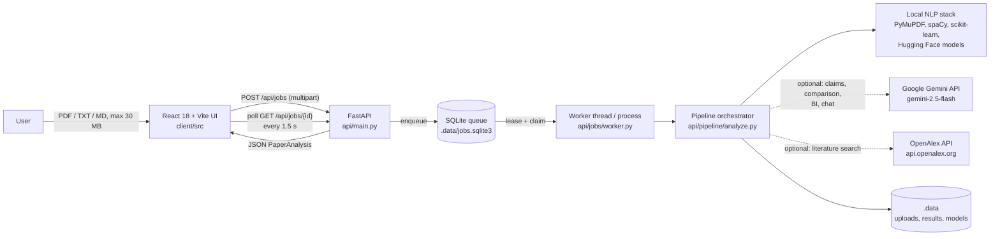
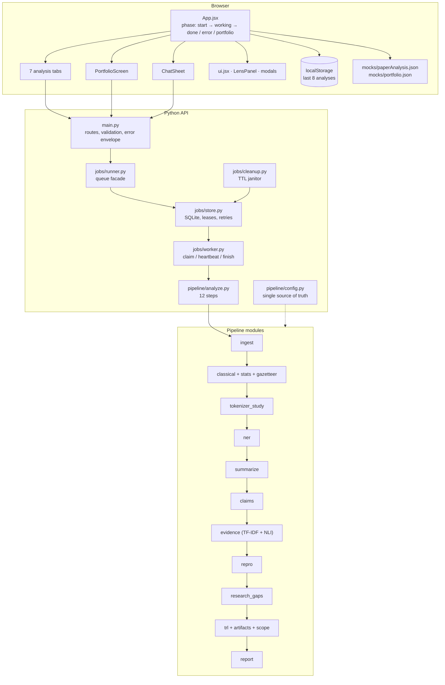
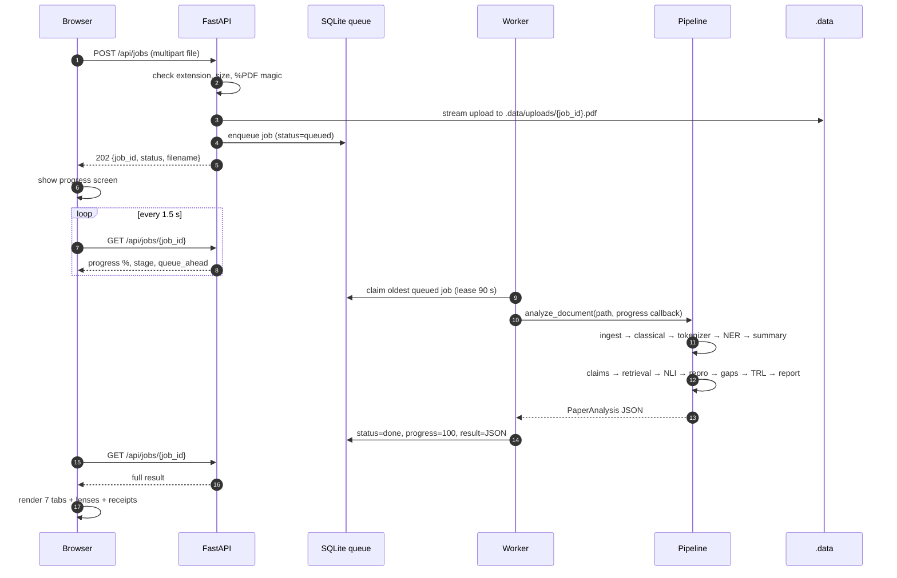
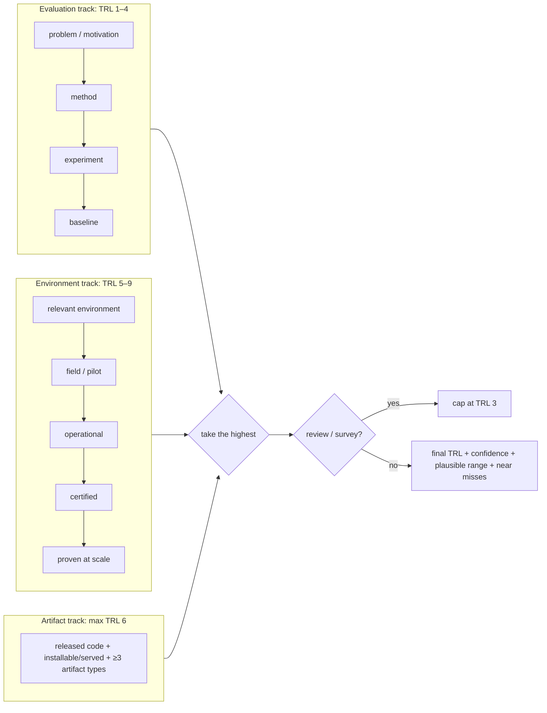
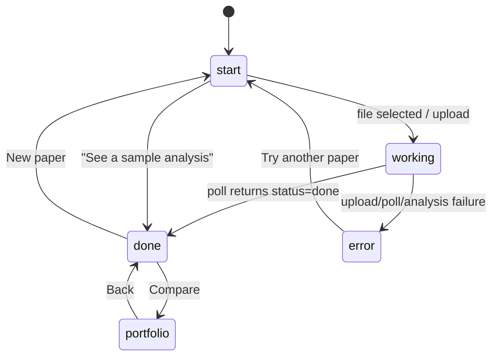
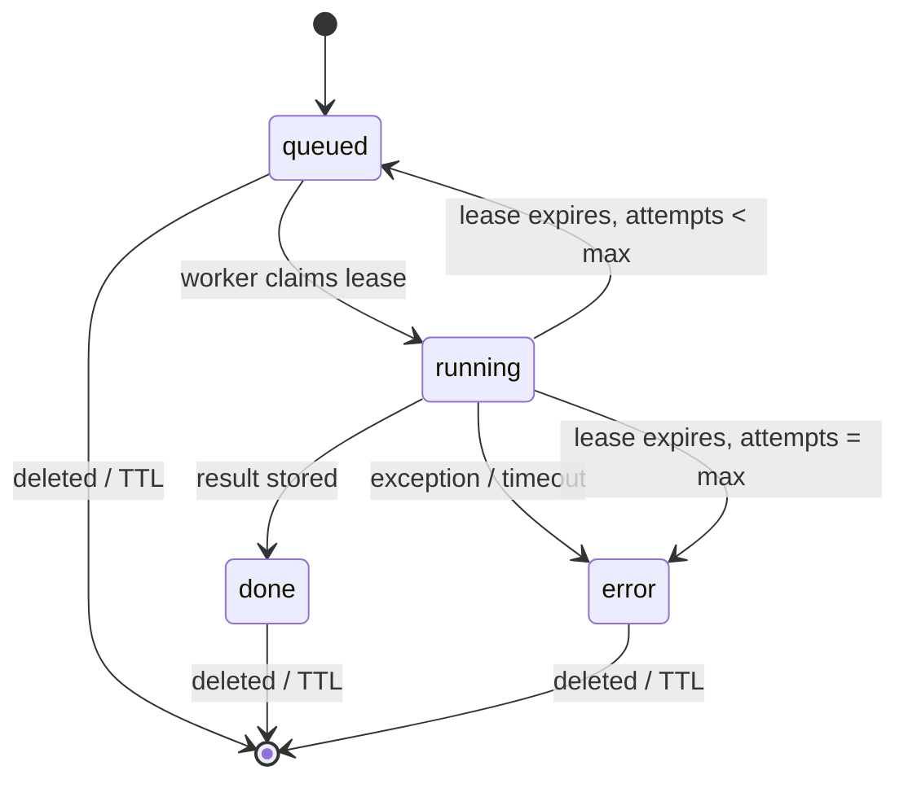

# ThesisTrace — Complete Project Overview

> **PaperLens tells you what the literature says. ThesisTrace tells you whether to build on it.**

**This document is the authoritative, end-to-end explanation of the repository.** It is written for two readers at once:

- a **human** who has never seen the project and wants to understand it without reading the code;
- an **LLM** that must answer questions about the project accurately, including what it uses, why, what is real, and what is still unfinished.

Everything below was checked against the code on **16 November 2026**. The API and pipeline both report version **`0.2.0`**. Where behaviour is a prototype or a known gap, it is labelled instead of hidden.

---

## 0. The 60-second answer

| Question | Short answer |
|---|---|
| **What is this?** | A local-first **research-to-product intelligence** web app. You upload **one** research paper (PDF / TXT / MD), and it returns an evidence-audited **readiness decision**, not a chat summary. |
| **What does it actually produce?** | A 3-bullet summary, a claim-by-claim **supported / partially supported / insufficient** verdict with page citations, a 12-signal **reproducibility score**, a **TRL 1–9** readiness level, a **research-gaps** list, a cited **executive report**, an **OpenAlex literature comparison**, a **commercialisation / business-intelligence** analysis, and an optional **grounded Q&A** drawer. |
| **What is the core idea?** | **Every verdict is a recorded decision, not a paragraph of prose.** Each claim carries a machine-readable *Trust Ledger* receipt: retrieval scores, NLI probabilities, thresholds, model id, pipeline version, timestamp, and abstain reason. |
| **Who is it for?** | Thesis writers, supervisors, lab leads, technology-transfer offices, R&D scouts, deep-tech investors, and founders deciding whether a paper is a real product ingredient. |
| **What is it NOT?** | Not a literature search engine, not a literature-review writer, not a cross-paper chatbot, not a fraud detector, not OCR, not peer review, not a real SaaS billing system yet. |
| **What does it run on?** | Python **FastAPI** API + **SQLite** durable job queue + local **Hugging Face / spaCy / scikit-learn** NLP pipeline, and a **React 18 + Vite 5** frontend. Runs on CPU. Docker Compose is the recommended path. |
| **Does it need an API key?** | **No** for core analysis. An optional **Google Gemini** key adds LLM claim proposals, research comparison, business intelligence, and grounded chat. Gemini **never assigns a verdict**. |
| **How accurate is it?** | On a **15-case developer-labelled seed set**, the lexical-fallback tier scores **0.667** verdict accuracy and **0.618** macro-F1. That is a regression guard, not a marketing claim. The model-backed NLI tier has not been evaluated on this checkout. |
| **What is unfinished?** | The `/api/portfolios` and `/api/jobs/{id}/audit` routes are implemented in modules but **not mounted** in `main.py`; billing is a UI/data prototype with **no real payment or auth**; one Windows-only test error remains. See [§22](#22-known-gaps-and-inconsistencies). |
| **Why choose it?** | It is deliberately narrow: **depth on one paper** instead of breadth across many. Deterministic judgement, explicit abstention, page-level provenance, local privacy, and a receipt trail. |

**One-sentence architecture:**

> A React upload screen posts a paper to FastAPI, which stores it in a SQLite queue; a worker runs a twelve-step NLP pipeline that retrieves evidence, judges claims with a cross-encoder NLI model, audits reproducibility and TRL with deterministic rubrics, and returns one JSON contract that the UI renders as seven tabs, a portfolio view, and an optional Gemini-grounded chat.

---

## 1. The problem it solves

A paper's abstract says:

> “Our method reduces inference latency by 42% compared with a dense Transformer.”

A summariser repeats that sentence. A citation tool lets you cite it. A chat assistant explains it. None of them answer the three questions a builder actually has:

1. **Is the claim supported by the paper's own evidence?** Same model, same data, comparable setting — or one favourable run?
2. **Can another team rebuild it?** Is the code released? Is the dataset public? Are seeds, splits, hyperparameters, and evaluation reported?
3. **How close is it to real use?** Lab demo, relevant environment, field pilot, or production?

ThesisTrace optimises for **depth on one paper**: evidence, reproducibility, readiness, and a receipt. Breadth is deliberately someone else's job.

### Real-life impact

| Stakeholder | Decision they face | Without ThesisTrace | With ThesisTrace | Practical impact |
|---|---|---|---|---|
| **Thesis student** | “Should I build my thesis on this paper?” | Days of reading; may discover missing code/seeds after committing | Minutes to a cited verdict, reproducibility score, and a gap list | Avoids weeks lost to an unreproducible baseline |
| **Supervisor / lab lead** | “Is my student's claim actually supported?” | Re-reads the paper and trusts memory | Claim-by-claim verdicts with page-level evidence and audit receipts | Faster, fairer review; disagreements become specific |
| **Technology-transfer office** | “Is this disclosure ready to license or pilot?” | Ad-hoc expert judgement, inconsistent vocabulary | TRL level, evidence quotes, artifact status, next missing evidence | Consistent screening and a shared readiness language |
| **R&D scout / deep-tech investor** | “Which of these five papers is worth a diligence call?” | Parallel reading, inconsistent notes | Readiness table plus a shared-claim ledger that flags disagreement | Cheaper first-pass diligence; conflicts surfaced early |
| **Founder / product lead** | “Is this paper a real product ingredient?” | Engineering team re-derives claims from scratch | Reproducibility gaps, TRL, commercialisation barriers, product opportunities | Better build-vs-buy and pilot decisions |
| **Researcher / reviewer** | “What exactly is missing from this work?” | Generic critique | 12 cited reproducibility signals, author-reported gaps, near-miss TRL evidence | Actionable revision list, not vague criticism |

The broader impact is a shift from **“the paper says X”** to **“the paper's own evidence supports X on page 6, documents 63/100 of the rebuild recipe, and stops at lab validation.”** That is the difference between a summary and a decision.

### Who it is for / not for

**For:** thesis writers, supervisors, lab leads, technology-transfer offices, R&D scouts, deep-tech investors, founders.

**Not for:** writing literature reviews; finding papers; free-form Q&A across a corpus; detecting fraud or proving a paper wrong; replacing peer review or domain experts.

---

## 2. What the product does — screen by screen

There are three screens: **Start**, **Analysis**, and **Portfolio**. Analysis currently has **seven tabs** (the README and Progress log still say four — they are stale).

| Tab | Question it answers | What the user sees | Data source | Needs Gemini? |
|---|---|---|---|---|
| **Summary** | What does this paper say? | 3 bullets, plain-English explanation, key concepts, coverage radar, three gauges (claims, TRL, reproducibility), and three **decision lenses** (researcher / engineer / business) | `summary`, `stats`, `key_concepts`, `trl`, `reproducibility` | No |
| **Claims** | Which statements survive their own evidence? | Claim text, verdict, page, optional note, **“Why this verdict?”** receipt, filter by verdict, audit-file download (endpoint missing — see §22) | `claims[].audit` | No |
| **Readiness** | How close is it to real use, and what is missing? | TRL gauge/ladder, 12 reproducibility signals with evidence, gaps blocking the next level | `trl`, `reproducibility` | No |
| **Research Gaps** | What is missing, reported by authors or by the audit? | Author-reported limitations, methodological gaps, evidence gaps, each with source, page, confidence | `research_gaps` | No |
| **Research Differentiator** | How does this paper differ from prior art? | Live OpenAlex search results, paper metadata/abstracts, novelty and methodology comparison | On-demand call: profile extraction + OpenAlex + Gemini | **Yes** |
| **Business Intelligence** | How could this research create real-world value? | Application areas, target industries/customers, product opportunities, commercialisation pathways, business models, barriers, validation steps, evidence-vs-hypothesis labels | On-demand call: profile + readiness context + Gemini | **Yes** |
| **Report** | What do I send to someone else? | Decision brief (call, evidence count, gap, next step) + five-section Markdown report + `.md` download | `report` | Optional polish (off by default) |

Plus:

- **Ask drawer** — grounded Q&A over retrieved paper passages **and** the pipeline's own findings; citations `[p.N]` and `[F#]` are enforced. Needs Gemini.
- **Portfolio screen** — pick 2–5 saved analyses, compare readiness and near-duplicate claims. Demo mode works from a fixture; the live API route is missing (§22).
- **Pricing / Settings / How to use** modals — plan display, theme switching, feature guide.
- **Demo mode** — “See a sample analysis” loads `client/src/mocks/paperAnalysis.json`, so the entire UI is inspectable without a backend.

### The bonus feature: one paper, three decisions

The Summary tab's **decision lenses** present the same structured facts through three stakeholder views:

- **Researcher** — strongest supported result, unresolved claims, next question.
- **Engineer** — documented-for-rebuild score, missing signals, readiness blocker.
- **Business** — readiness call, evidence count, next milestone.

The lens switch is **not** a new model call or a cosmetic filter. It is generated in `client/src/components/LensPanel.jsx` from the same claims, reproducibility checklist, and TRL result. Switching changes emphasis, not facts. That guarantees a researcher, an engineer, and a business reader cannot walk away with contradictory stories.

---

## 3. System architecture at a glance



### Component map



### Why the architecture looks like this

| Design choice | Reason |
|---|---|
| **API + background worker, not one long request** | A full analysis takes seconds to ~45 s on CPU — too long for a normal HTTP request. A queue survives restarts and lets the browser close and return. |
| **SQLite queue, not Redis/Celery** | Zero external services, project-local state, survives restart, easy to run on a laptop. Leases and retries are implemented directly. |
| **One JSON contract** | The UI is a view over one stable `PaperAnalysis` payload. Demo fixture uses the same shape, so the sample is an honest preview. |
| **Deterministic judgement, optional LLM prose** | Reproducible verdicts, no key required, no model cost for core use, and a defensible audit trail. |
| **Everything project-local** | Uploaded papers and model weights stay in `.data/`; deleting the folder removes the app's data. No system paths, no hidden volumes. |
| **Graceful degradation at every stage** | A missing model or library changes quality, not availability. The UI is told which method ran. |

---

## 4. Technology stack — what each thing is and why it was chosen

### Backend and runtime

| Layer | Technology | What it does here | Why this choice | If unavailable |
|---|---|---|---|---|
| **HTTP API** | **FastAPI** + **Uvicorn** | Upload, job status, report, chat, differentiation, business intelligence, billing routes | Typed request models, automatic OpenAPI docs at `/docs`, async uploads, simple local deployment | — |
| **Upload parsing** | **python-multipart** | Handles multipart file uploads | Required by FastAPI file uploads | Upload fails |
| **Validation** | **Pydantic** | Request schemas (`ChatRequest`, `CheckoutRequest`, etc.) | Explicit limits and typed payloads | — |
| **PDF reading** | **PyMuPDF** (`fitz`) | Extracts page text while preserving page numbers | Fast, reliable, no Java/Poppler dependency, page-level control | PDF ingest returns `MISSING_DEPENDENCY`; `.txt`/`.md` still work |
| **Queue durability** | **SQLite** (stdlib `sqlite3`) | Jobs, status, progress, leases, errors, results | Durable, zero-ops, project-local, WAL-friendly | — |
| **Classical NLP** | **scikit-learn** | `TfidfVectorizer` for key terms and cosine retrieval | Mature, fast, auditable; no GPU | Pure-Python TF-IDF fallback (`classical.TfidfIndex`) |
| **Linguistic features** | **spaCy** + `en_core_web_sm` | POS mix, complexity profile | Small, fast, CPU-only | Neutral POS defaults + warning |
| **Neural NLP** | **PyTorch (CPU)** + **Transformers** | NER, summarisation, NLI, optional embeddings, tokenizer comparison | One runtime for all Hugging Face models; CPU wheels keep Docker simple | Each stage has a fallback; see §11 |
| **Tokenizers** | **sentencepiece**, **safetensors** | T5 SentencePiece support, safe weights | Required by the chosen checkpoints | Unavailable rows explain why |
| **Optional LLM** | **Google Gemini REST** via `urllib` | Claim proposals, profile extraction, literature comparison, business intelligence, chat, optional report polish | No SDK dependency; free tier; easy to disable; prompts are provider-neutral | Heuristic claims, template report, chat/differentiator/BI return a clear `503` |
| **Literature search** | **OpenAlex REST** | Finds related academic works from the extracted profile | Free, no key, broad coverage, abstracts via inverted index | Comparison returns a warning and empty result |

### Frontend

| Layer | Technology | What it does | Why |
|---|---|---|---|
| **UI framework** | **React 18** | Component state, tabs, modals, chat drawer | Standard, familiar, no router needed for a single-page flow |
| **Build tool** | **Vite 5** | Dev server with `/api` proxy, production build | Fast cold start and simple config |
| **Charts** | **Recharts** | Coverage radar and gauges | Lightweight, declarative, no canvas code |
| **Styling** | Plain CSS (`client/src/styles.css`) | “Annotated paper / Marginalia” visual identity | No CSS framework; full control; offline fonts |
| **State** | React state + `localStorage` | Current analysis, phase, saved analysis metadata (max 8) | No global store needed; the document stays on the server |

### Infrastructure

| Layer | Technology | What it does | Why |
|---|---|---|---|
| **Containers** | **Docker** + **docker-compose** | API + web images, optional worker profile, mounted `.data/` | Reproducible environment; no host Python/Node setup |
| **Web serving** | **nginx** | Serves the Vite build, proxies `/api/` to `api:8000` | Standard production-ish static hosting |
| **Model cache** | `.data/hf` (host) mounted at `/models/hf` | Downloads weights once, survives rebuilds | Offline-friendly and delete-able |

### Course context: why the stack looks like an NLP syllabus

ThesisTrace is a **CSR322 (Natural Language Processing)** course project. Several technology choices exist because they demonstrate a specific syllabus area, not only because they are the fastest option.

| Practical / syllabus area | Where it lives | What it demonstrates |
|---|---|---|
| **1 — Tokenization** (word-level, BPE, WordPiece, SentencePiece) | `tokenizer_study.py` | The same text and technical terms split differently across tokenizer families |
| **2 — NER / information extraction** | `ner.py`, `gazetteer.py` | Hybrid transformer + curated lexicon extraction, with a low-RAM fallback |
| **3 — Text classification, NLI, prompting** | `evidence.py`, `claims.py`, `prompts/` | Zero/few-shot prompting vs a supervised cross-encoder; evaluation of both |
| **4 — Summarisation / NLG** | `summarize.py`, `report.py` | Abstractive vs extractive summarisation and grounded generation |
| **5 — Prompt-based vs classical baseline** | `claims.py`, `summarize.py` | The same task solved by an LLM prompt and by a deterministic heuristic |
| **6 — Evaluation and error analysis** | `eval/`, `api/tests/` | Accuracy, macro-F1, recall@k, citation coverage, N with caveats |
| **7 — Tokenization / prompt design impact** | `tokenizer_study.py`, `claims.py` | How tokenizer choice and prompt design change downstream behaviour |
| **8 — End-to-end pipeline** | `analyze.py`, `main.py`, `client/` | A complete service from upload to cited report |

This is also why the pipeline keeps a **classical tier** alongside the neural tier: TF-IDF, regex, POS, and gazetteer features are part of the syllabus, and they double as the graceful-degradation path.

---

## 5. The models — exactly which ones, what they do, and why

All models are loaded **lazily, once per process**, through `api/pipeline/models.py`. A load failure is recorded in `model_status()["errors"]` and the pipeline continues with a fallback. **No model name is hardcoded in a stage**; every name comes from `config.py`.

| Role | Default model | Low-RAM variant | Task | Why this model | Fallback when missing |
|---|---|---|---|---|---|
| **Claim judgement (NLI)** | `cross-encoder/nli-deberta-v3-small` | `distilbert-base-uncased-mnli` | Reads claim + passage **together**, returns entailment / neutral / contradiction probabilities | Cross-encoders are materially more accurate than comparing independent embeddings; this one is small enough for CPU and is a standard NLI checkpoint | Conservative **lexical-overlap** verdicts with the same receipt schema |
| **Named entities** | `elastic/distilbert-base-uncased-finetuned-conll03-english` | *(disabled — gazetteer only)* | Person / organisation / location spans | Small, fast, standard CoNLL03 checkpoint; the gazetteer supplies scientific types a general NER model lacks | Gazetteer-only mode + warning |
| **3-bullet summary** | `sshleifer/distilbart-cnn-12-6` | `google/flan-t5-small` | Abstractive summary of abstract + conclusion | Distilled BART is a strong CNN/DailyMail summariser at CPU cost | Extractive centrality-scored bullets |
| **Plain-English explanation (ELI5)** | `google/flan-t5-small` | same | Instruction-style rewrite for a non-specialist | Small instruction-tuned model; one download serves two roles | Extractive “In simple terms: …” |
| **Tokenizer comparison** | `gpt2` (BPE), `bert-base-uncased` (WordPiece), `google/flan-t5-small` (SentencePiece) | same | Shows how the same text and technical terms split | Covers the three tokenizer families taught in CSR322; all lightweight | Whitespace/punctuation baseline only |
| **Semantic embeddings** *(optional, `SEMANTIC=1`)* | `sentence-transformers/all-MiniLM-L6-v2` | same | Mean-pooled sentence embeddings for hybrid retrieval | Small, fast, good general-purpose similarity | TF-IDF-only retrieval |
| **Optional LLM** | `gemini-2.5-flash` | configurable via `GEMINI_MODEL` | Claim proposals, profile extraction, literature comparison, business intelligence, chat, report polish | Cheap/free-tier, long context, good JSON adherence | Every feature that needs it says so; core analysis unaffected |

### Why not “just use an LLM for everything?”

| Requirement | Deterministic pipeline | Single LLM |
|---|---|---|
| Same input → same verdict | ✅ fixed model + thresholds | ❌ sampling changes answers |
| Works offline / no key | ✅ | ❌ |
| Auditable decision | ✅ scores, thresholds, model id | ❌ prose only |
| Cheap at scale | ✅ milliseconds in fallback tier | ❌ per-token cost |
| Privacy of unpublished paper | ✅ local by default | ❌ sends text to a provider |
| Fluent explanation | ❌ | ✅ |

ThesisTrace therefore uses a **separation of powers**: the NLI cross-encoder **judges**, the deterministic rubrics **score readiness**, and the LLM only **proposes or writes prose over already-retrieved evidence**. A prompt injection or a hallucinating LLM cannot change a verdict, because verdicts never depend on a prompt.

### Model behaviour and honesty rules

- The claim's **own sentence is excluded** from retrieval. Otherwise the claim would prove itself and every verdict would look supported.
- If nothing clears the **retrieval floor (0.05)**, no NLI model is called. The verdict is `insufficient` with an explicit note — **unverified, not false**.
- Every LLM-proposed claim must appear **verbatim** in the document (normalised match, minimum length). Invented claims are rejected before the UI sees them.
- Every generated summary number must already exist in the source. A number that appears from nowhere is removed as a hallucination.
- Every report sentence must carry a valid `[p.N]` citation; uncited lines are dropped.
- The model actually used is always reported (`source`: `nli`, `lexical-fallback`, `retrieval-only`; receipt method; health endpoint).

---

## 6. End-to-end flow: from upload to decision



### The twelve pipeline stages

`api/pipeline/analyze.py` is the orchestrator. It records `*_ms` latency for every stage, turns every model failure into a warning, and returns **one JSON object**. It deliberately has no FastAPI import, so it can be tested with the standard library alone.

| # | Stage | Module | Input | Main output | Dependency / fallback |
|---|---|---|---|---|---|
| 1 | **Ingest** | `ingest.py` | PDF/TXT/MD | Pages, sections, page-preserving sentence index, title, reference/figure/table counts, injection flags | PyMuPDF for PDF; plain read for text |
| 2 | **Classical features** | `gazetteer.py`, `classical.py`, `stats.py` | Document + sentences | Gazetteer entities, regex facts, TF-IDF key terms, POS mix, complexity profile | scikit-learn or pure-Python TF-IDF; spaCy or neutral POS |
| 3 | **Tokenizer study** | `tokenizer_study.py` | Full text + technical terms | Token counts, vocab, tokens/word, term-splitting per tokenizer | HF tokenizers or baseline only |
| 4 | **NER + concepts** | `ner.py`, `gazetteer.py` | Document | Entities, key concepts grouped into models/datasets/metrics/others | DistilBERT or gazetteer-only |
| 5 | **Summary** | `summarize.py` | Abstract + conclusion | 3 bullets, ELI5, method (`abstractive`/`extractive`/`mixed`) | DistilBART / FLAN-T5 or extractive |
| 6 | **Claim extraction** | `claims.py` | Document + sentences | Up to 8 claims with type, page, section, sentence id | Gemini few-shot or transparent heuristic |
| 7 | **Retrieval** | `evidence.py`, `classical.py` | Claims + sentence index | Top-5 candidate passages with relevance scores | TF-IDF; optional hybrid embeddings |
| 8 | **NLI verdicts** | `evidence.py` | Claim + candidates | Verdict, confidence, evidence list, note, **audit receipt** | Cross-encoder or lexical fallback |
| 9 | **Reproducibility** | `repro.py` | Document + entities + facts | 12 weighted signals, score /100, summary, note | Pure regex/rules |
| 10 | **Research gaps** | `research_gaps.py` | Document + claims + repro | 3 gap categories with counts and limitations | Pure rules |
| 11 | **TRL** | `trl.py`, `scope.py`, `artifacts.py` | Document + claims + repro | Level 1–9, evidence, confidence, range, near misses, artifact status | Deterministic rubric; optional NLI confirmation for 5+ |
| 12 | **Report** | `report.py` | All structured outputs | 5-section Markdown + decision lists | Deterministic template; optional Gemini polish |

> **Note on stage numbering:** retrieval and NLI are one *logical* evidence stage in the orchestrator docstring, which is why it says “11 stages”; this table splits them into steps 7 and 8 to make the data flow explicit. The code comments also label both research gaps and TRL as “Stage 10” (a copy-paste artefact). The execution order above is authoritative.

### Stage details

#### Stage 1 — Ingest (`ingest.py`)

- PyMuPDF reads each page's text; page numbers are kept from this moment on.
- Cleanup removes lines repeated on most pages (running headers/footers), bare page numbers, and joins hyphenated line breaks.
- Section detection handles named headings (`Abstract`, `Method`, `Results`, `Conclusion`, `References`, …) and numbered headings (`3.2 Experiments`).
- Title is guessed from page 1, skipping licence banners and arXiv-style stamps.
- Text files become **pseudo-pages of ~2,800 characters**, so citations still work.
- Scanned PDFs with no text layer are rejected with a clear **“OCR is out of scope”** message, not silently analysed.
- The first **60 pages** are analysed; a truncation warning is emitted if the PDF is longer.
- Password-protected PDFs are rejected.
- Every line is scanned for **prompt-injection patterns**; suspicious lines are counted, warned about, and excluded from prompts and evidence.

**Why the page map matters:** a verdict without a page is an opinion. Every downstream output can cite `[p.N]`.

#### Stage 2 — Classical tier (`classical.py`, `gazetteer.py`, `stats.py`)

- **Gazetteer** finds known datasets, models, metrics, algorithms, organisations, and people.
- **Regex facts** pull percentages, p-values, metric values, artifact links.
- **TF-IDF key terms** surface distinctive terms.
- **POS statistics** (spaCy) feed the complexity profile.
- **Six-part complexity profile** behind the coverage radar: term density (0.30), sentence length (0.20), POS mix (0.10), references (0.15), structure (0.10), lexical variety (0.15), each 0–10.

**Why:** cheap, deterministic, and still useful on a laptop with no models installed.

#### Stage 3 — Tokenizer comparison (`tokenizer_study.py`)

Compares GPT-2 BPE, BERT WordPiece, T5 SentencePiece, and a whitespace/punctuation baseline. Shows vocabulary size, token count, tokens per word, unknown-token rate, and how technical terms shatter into subwords.

**Honesty note:** this stage is computed and stored in the JSON, but the current UI has no tokenizer screen. It exists for the NLP syllabus and technical inspection. It is **not** part of the readiness decision.

#### Stage 4 — NER and key concepts (`ner.py`, `gazetteer.py`)

A small DistilBERT CoNLL model finds Person/Organisation/Location; the gazetteer adds datasets, models, algorithms, and metrics. Merge rule: model wins token boundaries, gazetteer wins the type of a known term. Every entity records its source and page.

**Why:** gives a non-specialist a quick map of what the paper is made of.

#### Stage 5 — Summary (`summarize.py`)

- DistilBART writes the bullets; FLAN-T5 writes the plain-English explanation.
- If models are unavailable, an **extractive fallback** scores sentences by centrality, numbers, and early position, removes near-duplicates, and selects three.
- Every number in generated text must already exist in the source; otherwise the bullet is removed and the warning says so.
- The result records whether it was `abstractive`, `extractive`, or `mixed`.

**Why:** short enough to read, honest enough to include the limitation.

#### Stage 6 — Claim extraction (`claims.py`)

- **Baseline:** transparent heuristic over result-like sentences. It prefers abstract/conclusion/results/experiments; looks for subject–verb patterns (“we show”, “the method reduces”), result verbs (“reduces”, “outperforms”, “achieves”), numbers, and comparisons; penalises background/future-work wording; removes near-duplicates with Jaccard > 0.75; keeps at most 8.
- **Optional Gemini path:** a few-shot prompt proposes claims. Every proposed claim is then checked **verbatim** against the document. A claim not literally present is rejected before the user sees it.

**Why:** claim selection is the first place an LLM could invent something; the verbatim guard makes that failure mode visible and bounded.

#### Stage 7 — Retrieval (`evidence.py`, `classical.py`)

- All usable sentences are indexed with TF-IDF.
- Each claim retrieves the **top 5** most similar sentences by cosine similarity.
- The claim's **own sentence is excluded**.
- Reference/bibliography/acknowledgement/appendix sections and instruction-like sentences are excluded.
- If the best candidate scores below **0.05**, no model is called; the verdict is `insufficient` with an explicit note.

**Optional hybrid mode:** when `SEMANTIC=1` and the embedding model loads, retrieval blends semantic similarity (0.6) with lexical score (0.4), with separate thresholds. This code path exists but is **experimental**: `analyze.py` still emits a stale warning saying semantic reranking is future work, and `.env.example` labels it future work. Treat `SEMANTIC=1` as unsupported-by-default.

#### Stage 8 — NLI judgement (`evidence.py`)

A cross-encoder reads the claim and each of the top **3** candidate passages together and returns three probabilities. Candidate ranking uses:

```
choice = 0.6 × entailment + 0.4 × relevance − 0.1 × contradiction
```

The decision rules are explicit:

| Condition | Verdict | Meaning |
|---|---|---|
| entailment ≥ **0.60** and relevance ≥ **0.25** | `supported` | The passage entails the claim as written |
| entailment ≥ **0.40** and relevance ≥ **0.12** | `partially_supported` | Related, but broader/different scope, missing number, or hedge |
| contradiction ≥ **0.65**, greater than entailment, relevance ≥ floor | `insufficient` | The paper does not support it as stated (treat as contradicted) |
| anything else | `insufficient` | Unverified — **not false** |

**If the NLI model is unavailable**, a conservative lexical fallback runs:

| Condition | Verdict |
|---|---|
| ≥ 55% content-word overlap **and** all claim numbers appear in the passage | `supported` |
| ≥ 28% content-word overlap | `partially_supported` |
| otherwise | `insufficient` |

The interface always says which method ran. The fallback is **not** presented as equivalent to NLI.

#### Stage 9 — Reproducibility audit (`repro.py`)

Twelve signals, each **yes** (1 point), **partial** (0.5), or **no** (0), each with a quoted line and page when found. Total weight **15**.

| # | Signal | Weight | What counts as present |
|---|---|---|---|
| 1 | Dataset availability | 2 | Public dataset, repository link, data statement |
| 2 | Source code availability | 2 | GitHub/GitLab link, “code is available” |
| 3 | Model architecture details | 1 | Named model **and** architecture/hyperparameter description |
| 4 | Hyperparameters | 2 | Learning rate, batch size, epochs, optimizer, etc. (≥2 signals for “yes”) |
| 5 | Preprocessing | 1 | Tokenisation, normalisation, augmentation, cleaning |
| 6 | Random seed | 1 | Explicit seed value or “fixed seed” |
| 7 | Software environment | 1 | `requirements.txt`, Docker, PyTorch/TensorFlow version, Python version |
| 8 | Experimental procedure | 1 | Explicit step sequence in a substantial method section |
| 9 | Train/validation/test split | 1 | Split description or ratios |
| 10 | Sample size | 1 | `N = …` or “N samples/participants” |
| 11 | Baseline comparison | 1 | Baseline, state of the art, control group |
| 12 | Evaluation metrics | 1 | Metric value or named metric |

**Important limitation:** this is a **text-level audit**. The app does not run the paper's code. A paper can score 100/100 and still fail to reproduce. The score measures **what is documented**, not what is true.

#### Stage 10 — Research gaps (`research_gaps.py`)

Three deterministic categories:

| Category | Source | What it flags | Confidence |
|---|---|---|---|
| **Author-reported** | Paper text | Sentences with “future work”, “limitation”, “remains unexplored”, “out of scope” | High |
| **Methodological** | Reproducibility signals marked `no` or `partial` | Missing or incomplete reporting | Medium |
| **Evidence** | Claims marked `insufficient` or `partially_supported` | Claims the paper's own retrieved evidence does not fully support | Medium |

The module also returns explicit limitations: findings are based only on the analysed paper; missing details are potential reporting gaps, not proof of flawed research; insufficient evidence does not mean false; novelty across the wider literature has not been established.

**Why:** a readiness decision is only actionable if it names what is missing.

#### Stage 11 — TRL 1–9 (`trl.py`, `scope.py`, `artifacts.py`)

TRL is a **deterministic rubric over what the paper says about its own work**. An LLM never assigns it.



| Level | Label | Evidence required |
|---|---|---|
| 1 | Basic principles observed | Problem/motivation statement |
| 2 | Technology concept formulated | Method description |
| 3 | Experimental proof of concept | Experimental evaluation |
| 4 | Technology validated in lab | Baseline comparison |
| 5 | Technology validated in relevant environment | Real-world/relevant environment statement about the authors' own system |
| 6 | Technology demonstrated in relevant environment | Field/pilot evidence |
| 7 | System prototype demonstrated in operational environment | Operational deployment wording |
| 8 | System complete and qualified | Certification/qualification wording |
| 9 | Actual system proven in operational environment | Sustained operation at scale |

**Deliberately suspicious rules:**

- Related work and future-work sections never count as evidence.
- A negation (“no field trial was conducted”) does not count.
- Hedging (“can be deployed”, “may be used”) does not count for 5–9.
- A sentence about someone else's system does not count.
- “Real-world datasets” or “large-scale ImageNet” is not evidence of a real-world environment.
- A review or survey is capped at TRL 3.
- Environment and artifact tracks only count if the paper also contains an experimental evaluation.
- Optional NLI confirmation can reject a level-5+ match; if unavailable, the regex result stands and `nli_checked` is false.

The result includes a **confidence**, a **plausible range**, and the higher-level mentions that were rejected and why. That is what makes it defensible.

**Artifact track (`artifacts.py`):** ten artifact types — source released, installable package, container, API/SDK/service, live demo, versioned release, tests/CI, documentation, open licence, reported adoption. Each is `available`, `promised`, or absent, with a page citation. Promised artifacts never count. `level_hint` never exceeds 6, because operational use needs deployment evidence, not just a repository.

#### Stage 12 — Executive report (`report.py`)

Five deterministic sections:

1. What the paper achieved
2. What is proven
3. What is not proven
4. Main risks
5. Recommended next steps

Every factual bullet carries a `[p.N]` citation. An optional Gemini pass (`LLM_REPORT=1`, **off by default**) may rewrite only sections 3 and 4. Its output is filtered mechanically: any sentence without a valid page citation is dropped. If nothing valid remains, the template report is used.

The Report tab also shows a **Decision Brief**: readiness call, evidence count, one concrete gap, and the next step. It is a reading of the evidence, not an investment recommendation.

---

## 7. The verdict system: how to read every number

| Number / label | What it means | What it is **not** |
|---|---|---|
| **Supported** | Retrieval found a relevant passage and NLI entailment cleared the threshold | Proof that the claim is true in the real world |
| **Partially supported** | The passage is related, but the claim is broader or slightly different | A polite “supported” |
| **Insufficient / unverified** | Nothing cleared the thresholds, or the paper contradicts the claim | Proof that the claim is false |
| **Confidence** | A calibrated-looking score derived from entailment and relevance; it ranks verdicts | A probability that the paper is correct |
| **Retrieval relevance** | Cosine similarity between claim and candidate sentence | A judgement of truth |
| **NLI entailment** | The model's probability that the passage entails the claim | Human peer review |
| **TRL** | The highest level for which the paper's own wording supplies evidence | A market forecast or investment rating |
| **Reproducibility score** | How much of the 12-signal documentation is present | A guarantee that the result reproduces |
| **N** | The number of examples a measured result is based on | Statistical significance |

**The app is built to abstain.** An abstention is a feature: it tells you where the paper has not earned your trust yet.

---

## 8. The Trust Ledger (the receipt)

Every claim carries an `audit` object. This is the core differentiator: a citation says “look at page 6”; a receipt says “this is the passage, this is the score, this is the threshold, this is the model, and this is the pipeline version that produced it.”

```json
{
  "receipt_version": 1,
  "pipeline_version": "0.2.0",
  "checked_at": "2026-11-16T10:22:31+00:00",
  "method": "nli",
  "verdict": "supported",
  "confidence": 0.91,
  "retrieval": {
    "engine": "tf-idf",
    "k": 5,
    "floor": 0.05,
    "returned": 5,
    "candidates": [
      { "sentence_id": 142, "page": 6, "score": 0.87 }
    ]
  },
  "nli": {
    "model": "cross-encoder/nli-deberta-v3-small",
    "max_candidates": 3,
    "thresholds": {
      "supported_entailment": 0.6,
      "supported_relevance": 0.25,
      "partial_entailment": 0.4,
      "partial_relevance": 0.12,
      "contradiction": 0.65
    },
    "best_sentence_id": 142,
    "best_relevance": 0.87,
    "entailment": 0.94,
    "contradiction": 0.02,
    "margin": 0.92
  },
  "abstained": false,
  "reason": ""
}
```

Key properties:

- **No document text is stored in the receipt**, so it is safe to export.
- `method` is always one of `nli`, `lexical-fallback`, `retrieval-only`.
- `reason` records why the system abstained, when it did.
- The same thresholds are echoed in the receipt, so a future threshold change does not silently reinterpret old results.
- The UI exposes it under **“Why this verdict?”**.
- The JSON is available in the analysis payload (`claims[].audit`), but the dedicated `GET /api/jobs/{id}/audit` route is **not mounted yet** (see §22).

---

## 9. The JSON contract

The worker stores one object; the browser renders that object. Top-level keys:

| Field | Type | Meaning |
|---|---|---|
| `job_id` | string | Job identifier (added by the job wrapper) |
| `status` | string | `done` at completion |
| `progress` | int | 100 at completion |
| `stage` | string | Human-readable final stage |
| `filename` | string | Original upload name |
| `doc` | object | `filename`, `title`, `pages`, `words`, `source`, `truncated`, `page_count_total`, `injection_flags` |
| `stats` | object | Words, unique words, reading time, sections, references, figures, tables, term density, average sentence length, complexity score/parts, POS summary |
| `summary` | object | `bullets[3]`, `eli5`, `abstractive_supported`, `method`, `eli5_method` |
| `entities` | array | Entity spans with type, page, source, canonical name |
| `key_concepts` | object | `models`, `datasets`, `metrics`, `others`; each item has `name`, `type`, `count`, `pages` |
| `claims` | array | Claim `id`, `text`, `claim_type`, `section`, `page`, `sentence_id`, `extraction`, `verdict`, `confidence`, `evidence[]`, `note`, `source`, **`audit`** |
| `reproducibility` | object | `score`, `items[12]`, `summary`, `note` |
| `research_gaps` | object | `total_gaps`, `category_counts`, `gaps[]`, `limitations[]` |
| `trl` | object | `level`, `label`, `evidence[]`, `why`, `signals`, `review_document`, `note`, `confidence`, `level_range`, `near_misses`, `nli_checked`, `sections_recognised`, `artifacts` |
| `report` | object | `achieved`, `proven`, `not_proven`, `risks`, `next_steps`, `markdown` |
| `tokenization` | object | `tokenizers[]`, `term_splits[]`, `note` |
| `key_terms` | array | TF-IDF key terms with scores/pages |
| `signals` | object | Regex facts: percentages, p-values, metric mentions, links |
| `timings` | object | Per-stage milliseconds + `total_ms` |
| `warnings` | array | Every degradation, fallback, rejection, and caveat from the run |
| `pipeline_version` | string | `0.2.0` |
| `engine` | object | `tfidf` backend, `pos` availability, tokenizer count, `gemini` enabled |

A queued job returns only `job_id`, `status`, `progress`, `stage`, `filename`, `created_at`, `updated_at`, and `queue_ahead`. A finished job's result is merged into the same payload, so the client has one contract to handle.

### The demo fixture (also the running example)

`client/src/mocks/paperAnalysis.json` is a nine-page paper, **SparseRoute: Adaptive Sparsity for Efficient Neural Machine Translation**:

| Property | Value |
|---|---|
| Pages / words / reading time | 9 / 4,812 / 22 min |
| Sections / references | 7 / 34 |
| Claims | 6 total: **2 supported**, **2 partially supported**, **2 insufficient** |
| TRL | **4 / 9** (“Technology validated in lab”), medium confidence, range 4–5 |
| Reproducibility | **63 / 100**: 5 present, 3 partial, 4 missing |
| Summary method | Abstractive (DistilBART) |
| Engine | scikit-learn TF-IDF, spaCy POS available, 4 tokenizers, Gemini off |
| Research gaps | **Absent** — the fixture predates the gaps stage, so the Research Gaps tab is empty in demo mode |

The demo portfolio fixture (`client/src/mocks/portfolio.json`) compares two papers: 11 claims, 2 shared, **1 conflict, 1 agreement**.

---

## 10. API surface — what is actually mounted

All routes are in `api/main.py`. Errors use a consistent envelope:

```json
{ "status": "error", "error": { "code": "JOB_NOT_FOUND", "message": "That analysis job does not exist." } }
```

| Method | Path | Purpose | Notes |
|---|---|---|---|
| `GET` | `/` | Name, version, docs link | Still says “Paper2Reality” (legacy name) |
| `GET` | `/api/health` | Status, loaded models, dependency check, queue stats | Safe to poll |
| `GET` | `/api/config` | Feature flags, limits, retention, model errors | Never returns the key |
| `POST` | `/api/jobs` | Upload PDF/TXT/MD → `202` + `job_id` | 30 MB, checks extension, empty file, `%PDF-` magic |
| `GET` | `/api/jobs/{id}` | Progress, then full `PaperAnalysis` | Main polling route |
| `DELETE` | `/api/jobs/{id}` | Delete a job and its upload | Refuses a running job (`409`) |
| `GET` | `/api/jobs/{id}/report?format=md` | Download the Markdown report | `Content-Disposition` attachment |
| `POST` | `/api/jobs/{id}/chat` | Grounded Q&A | Requires Gemini; `503 CHAT_DISABLED` without a key |
| `POST` | `/api/jobs/{id}/differentiate?limit=8` | OpenAlex literature search + comparison | Requires Gemini; `limit` 1–20 |
| `POST` | `/api/jobs/{id}/business-intelligence` | Commercialisation analysis | Requires Gemini |
| `GET` | `/api/billing/plans` | Plan catalogue, FAQs, provider status | Static config |
| `GET` | `/api/billing/subscription` | Current plan, usage, entitlements | Single global store |
| `POST` | `/api/billing/checkout` | Checkout session or “not configured” | No real session is created |
| `POST` | `/api/billing/plan` | Change plan | **No auth, no payment** — simulation only |
| `POST` | `/api/billing/cancel` | Cancel at period end | Persists a flag |
| `POST` | `/api/billing/webhook` | Accept provider webhook | Currently just counts bytes; no signature verification |
| `GET` | `/docs` | FastAPI OpenAPI UI | Served automatically |

### Routes the client calls but the API does not mount

| Client call | Called from | Status |
|---|---|---|
| `GET /api/jobs/{id}/audit` | `ClaimsTab.jsx` “Audit file” | **404** — the receipt data exists inside each claim, but the aggregate route is not implemented |
| `POST /api/portfolios` | `PortfolioScreen.jsx` “Compare” | **404** — `pipeline/portfolio.py` and its tests exist, but `main.py` imports the module without adding a route |
| `GET /api/portfolios/{id}` | `api.js` helper | **404** — same reason |

Demo mode hides these gaps because it uses stored fixtures. This is the single most important “implemented vs wired” distinction in the repository.

---

## 11. Graceful degradation: what happens when something is missing

This is a core design promise: **a missing dependency changes quality, not availability.**

| Missing piece | Behaviour | What the user sees |
|---|---|---|
| PyMuPDF | PDF ingest fails with a clear message; `.txt`/`.md` still work | “PDF support needs PyMuPDF…” |
| spaCy model | POS features use neutral defaults | Warning + lower-fidelity complexity profile |
| scikit-learn | Pure-Python TF-IDF still retrieves | Engine says `pure-python` |
| Transformers / torch | No NER model, no neural summary, no NLI, baseline tokenizers only | Multiple warnings; extractive summary; lexical verdicts |
| NLI model | Lexical-overlap verdicts with full receipts | `source: lexical-fallback`, method shown |
| DistilBART | FLAN-T5 or extractive bullets | `summary.method` reflects it |
| Gemini key | Heuristic claims, template report, chat/differentiator/BI disabled | Clear messages; core analysis still complete |
| OpenAlex unreachable | Differentiator returns a warning and no papers | Empty comparison, not a crash |
| Embedding model (`SEMANTIC=1`) | TF-IDF-only retrieval | Retrieval engine stays `tf-idf` |

---

## 12. Frontend architecture

`client/src/App.jsx` is a small state machine:



| File | Responsibility |
|---|---|
| `App.jsx` | Phases, upload validation, polling every 1.5 s, saved analyses in `localStorage` (max 8), tab state, modal state |
| `api.js` | Fetch wrappers for every endpoint, consistent error extraction |
| `tabs/SummaryTab.jsx` | Bullets, ELI5, concepts, coverage radar, three gauges, lens panel |
| `tabs/ClaimsTab.jsx` | Verdict filters, evidence disclosure, Trust Ledger receipt, audit download |
| `tabs/ReadinessTab.jsx` | TRL ladder, reproducibility score, 12 signals, gaps |
| `tabs/ResearchGapsTab.jsx` | Three gap categories, expandable evidence |
| `tabs/ResearchDifferentiatorTab.jsx` | On-demand OpenAlex comparison, loading/error/notice states |
| `tabs/BusinessIntelligenceTab.jsx` | On-demand commercial analysis with filters |
| `tabs/ReportTab.jsx` | Decision brief, Markdown render, copy/download |
| `tabs/ChatSheet.jsx` | Ask drawer, history, citations, source list |
| `components/PortfolioScreen.jsx` | Paper picker, readiness table, shared-claim ledger |
| `components/LensPanel.jsx` | Researcher / engineer / business views generated from the same data |
| `components/ui.jsx` | Icons, gauges, radar, tags, empty states |
| `components/PricingModal.jsx` / `SettingsModal.jsx` / `HowToUseModal.jsx` | Plan display, theme, guide |
| `mocks/paperAnalysis.json`, `mocks/portfolio.json` | Full demo experience with no backend |
| `theme.js` | Light/dark theme persistence |

**Saved history:** only lightweight metadata (`job_id`, title, pages, TRL, reproducibility, supported/total claims) is stored in the browser. The paper and result stay on the server. This is why returning after a server restart may still show the history entry but the job may have expired.

---

## 13. Job queue and runtime behaviour



| Property | Default | Meaning |
|---|---|---|
| `JOB_MODE` | `inline` | API process runs worker threads |
| `JOB_WORKERS` | `1` | One CPU-heavy analysis at a time |
| `JOB_MAX_QUEUE` | `20` | Queued + running; above this uploads get `503` + `Retry-After` |
| `JOB_MAX_ATTEMPTS` | `2` | Retries only for crashed workers |
| `JOB_LEASE_SECONDS` | `90` | A worker must keep heartbeating; expired leases are recovered |
| `JOB_TIMEOUT_SECONDS` | `900` | A job running longer is failed |
| `JOB_MAX_STORED` | `200` | Cap on finished jobs kept |
| `UPLOAD_TTL_SECONDS` | `86,400` in config; **`3,600` in Docker Compose** | Uploaded file deletion |
| `RESULT_TTL_SECONDS` | `86,400` | Whole analysis deletion |
| `CLEANUP_INTERVAL_SECONDS` | `300` | Janitor cadence |

**Zombie protection:** a progress update from an old worker cannot overwrite a retried job; updates are scoped by `job_id + worker + status='running'`.

**External worker mode:** `THESISTRACE_JOB_MODE=external` plus `python -m api.jobs.worker` (or the Compose `scale` profile). Both processes share the SQLite file. This is recommended on a Linux host; SQLite WAL across Docker Desktop bind mounts shared by two containers is unreliable.

---

## 14. Configuration reference

All settings are read in `api/pipeline/config.py`. The preferred prefix is `THESISTRACE_`; legacy `P2R_` names still work as a fallback.

| Variable | Default | What it controls |
|---|---|---|
| `GEMINI_API_KEY` | empty | Enables optional LLM features |
| `GEMINI_MODEL` | `gemini-2.5-flash` | Model id |
| `GEMINI_TIMEOUT` | `8` | Claim/profile/comparison timeout (seconds) |
| `GEMINI_CHAT_TIMEOUT` | `30` | Chat timeout |
| `LOW_RAM` | `0` | Small models, gazetteer-only NER |
| `SEMANTIC` | `0` | Experimental hybrid retrieval |
| `EMBEDDING_MODEL` | `sentence-transformers/all-MiniLM-L6-v2` | Embedding checkpoint |
| `THESISTRACE_TOKENIZER_STUDY` | `1` | Run the tokenizer comparison |
| `THESISTRACE_LLM_CLAIMS` | `1` | Allow Gemini claim proposals when a key exists |
| `THESISTRACE_LLM_REPORT` | `0` | Allow Gemini report polish |
| `THESISTRACE_DATA_DIR` | `<repo>/.data` | Uploads, results, queues, model cache |
| `MAX_UPLOAD_MB` | `30` | Upload size limit |
| `MAX_PAGES` | `60` | Pages analysed |
| `THESISTRACE_JOB_*` | see §13 | Queue, lease, timeout, TTL, retention |
| `STRIPE_SECRET_KEY` / `RAZORPAY_KEY_ID` | empty | Billing provider presence check only |

### Hard limits

| Limit | Value |
|---|---|
| Upload size | 30 MB |
| Pages analysed | 60 |
| Claims per paper | 8 |
| Evidence sentences indexed | 1,400 |
| Retrieval candidates | 5 |
| NLI candidates | 3 |
| Portfolio papers | 5 |
| Ledger entries | 12 |
| Entities shown | 90 |
| Chat question | 1,000 characters (API model allows 4,000) |
| Chat history | 6 turns |
| Chat retrieved passages | 8 + up to 4 abstract sentences |
| Differentiator papers | 1–20 (default 8; prompt uses top 8) |

---

## 15. Storage, privacy, and security

### Where data lives

| Data | Location | Lifetime |
|---|---|---|
| Uploaded paper | `.data/uploads/{job_id}.{ext}` | Upload TTL (24 h default; 1 h in Compose) |
| Job + result JSON | `.data/jobs.sqlite3` | Result TTL (24 h) |
| Portfolio JSON | `.data/portfolios/{id}.json` | Until deleted (module-level; no HTTP route) |
| Billing state | `.data/billing.json` | Persistent, single global record |
| Model weights | `.data/hf` (Compose: `/models/hf`) | Until deleted |
| Browser history | `localStorage` key `thesistrace.analyses.v1` | Persistent, max 8 entries |
| Screenshots | `documentation/screenshots/` | Repository assets |

Deleting `.data/` removes runtime data. The repository never writes outside the project unless `THESISTRACE_DATA_DIR` explicitly points elsewhere.

### What leaves the machine

| Feature | Data sent | Destination |
|---|---|---|
| Core analysis | Nothing | — |
| Claim extraction with key | Abstract + results + conclusion (≤9,000 chars), sanitised | Google Gemini |
| Research Differentiator | Extracted profile + related paper abstracts (≤18,000 chars) | Google Gemini; search query to OpenAlex |
| Business Intelligence | Research profile + TRL/reproducibility context | Google Gemini |
| Chat | Question, history, selected findings, retrieved passages | Google Gemini |
| Report polish (opt-in) | Structured analysis JSON | Google Gemini |

The chat never sends the whole file: only retrieved passages and pipeline findings. The key is never returned to the browser; `/api/config` exposes only a boolean.

### Security posture

| Threat | Mitigation | Residual risk |
|---|---|---|
| Prompt injection in a paper | Instruction-like lines detected, warned about, removed from prompts and evidence; document treated as data; vicdicts never prompt-dependent | A novel phrasing may evade detection; it still cannot change a verdict |
| Hallucinated claim | Verbatim check against the document | Near-verbatim paraphrase is rejected too, which is conservative |
| Hallucinated number in summary | Every number must exist in the source | A number can exist but be misattributed |
| Hallucinated citation in report/chat | Citation filter drops invalid `[p.N]` / `[F#]` tags | Valid page but wrong interpretation remains possible |
| Malicious upload | Extension allowlist, empty check, `%PDF-` magic bytes, size cap, no execution | Parsing bugs in PyMuPDF are outside the app's control |
| Path traversal in filename | `_safe_filename` strips directories | — |
| Secret leakage | Key only in server config; never logged or returned | Operator must protect `.env` |
| Cross-origin abuse | CORS allows only localhost:5173/8080 | No authentication; anything that can reach the API can use it |
| Unauthorised billing change | None | `POST /api/billing/plan` can change the plan without payment — prototype only |
| Multi-user isolation | None | Single-user local app; not a hosted multi-tenant service |

**Honest summary:** this is a **local, single-user research prototype**, not a hardened public SaaS. There is no authentication, no per-user quota enforcement, and no tenant isolation.

---

## 16. Running and deploying

### Docker Compose (recommended)

```bash
cp .env.example .env          # optional: add GEMINI_API_KEY
docker compose up --build
```

| Service | Host URL | Internal |
|---|---|---|
| Web UI | **http://localhost:8080** | nginx :80 |
| API | **http://localhost:8001/api/health** | uvicorn :8000 |

> The Compose file maps **8001:8000** for the API. The README's `localhost:8000` line is stale; use **8001** when the API runs through Compose, or **8000** when running uvicorn directly.

Warm the model cache before a demo:

```bash
docker compose run --rm api python -m api.pipeline.warmup
```

Optional scaled worker:

```bash
THESISTRACE_JOB_MODE=external docker compose --profile scale up --build
```

### Local development

```bash
# Python
py -V:3.12 -m venv .venv
export UV_CACHE_DIR="$PWD/.data/pip-cache"
uv pip install --python .venv fastapi uvicorn python-multipart pydantic PyMuPDF

# API
.venv/Scripts/python.exe -m uvicorn api.main:app --host 127.0.0.1 --port 8000

# UI (second terminal)
cd client
npm install --cache="../.data/npm-cache" --no-audit --no-fund
npm run dev        # http://127.0.0.1:5173, proxies /api
```

The minimal install is enough to run the app; every missing heavy dependency degrades gracefully. The full model stack is `pip install -r requirements.txt` plus `python -m spacy download en_core_web_sm`.

### Useful commands

```bash
# Tests (stdlib unittest only)
python -B -m unittest discover -s api/tests -t . -v

# Claim-verdict / retrieval / timing evaluation
python eval/run_eval.py --analyze

# TRL-specific evaluation
python eval/run_trl_eval.py

# UI production build
cd client && npm run build
```

---

## 17. Testing and evaluation: how strong is the evidence?

### Test suite

`api/tests/` uses the standard-library `unittest` framework — **no installs required**. It covers:

sentence splitting, ingest/sections, TF-IDF retrieval, claim verbatim checks, NLI-free evidence fallback, reproducibility, TRL negation/review caps, artifacts, report citation enforcement, prompt injection, job lifecycle/queue, billing, chat, chat findings, differentiation, business intelligence, portfolio, prompts, tokenizer study, client fixture shape, and the full JSON contract.

**Current status on this Windows checkout:** **161 tests ran in ~34 s, 160 passed, 1 error.** The error is `test_job_queue.QueueApiTests.test_a_fake_pdf_is_rejected_before_it_is_queued`: `main.py` tries to `unlink` the uploaded file while it is still open for the magic-byte check. POSIX allows that; Windows raises `WinError 32`. See §22.

### Evaluation results (lexical-fallback tier)

| Metric | Result | N | Caveat |
|---|---|---|---|
| Verdict accuracy | **0.667** | 15 | Developer-labelled seed set |
| Macro-F1 | **0.618** | 15 | Three classes |
| Retrieval recall@5 | **1.000** | 8 | Small retrieval subset |
| Citation coverage | **1.000** | 9 | Every verdict had a page |
| Mean pipeline time | **15.9 ms** per paper | 7 | Fallback tier on this machine |

**What this is not:** the 15 labels were written by the developer, not by two independent raters. The NLI tier has not been evaluated with models on this checkout. The model-backed tier has not been timed on deployment hardware. These numbers are a regression guard and an honesty device, not a product claim.

### TRL evaluation

`eval/run_trl_eval.py` + `eval/gold/trl_gold.json` + `eval/corpus/` cover edge cases such as theory-only papers, benchmark-only work, hedged future deployment, promised code, third-party links, related-work deployment by others, released toolkits, surveys, testbed validation, and user-survey field studies. This is how the rubric's “suspiciousness” is tested rather than asserted.

---

## 18. Why choose ThesisTrace?

### Product-level reasons

| Requirement | How ThesisTrace meets it |
|---|---|
| **A decision, not a summary** | Claim verdicts + reproducibility + TRL + gaps + receipt |
| **Trust** | Deterministic thresholds, page citations, model id, pipeline version, timestamp |
| **Honesty about uncertainty** | Explicit `insufficient`; confidence and plausible range; warnings for every fallback |
| **Privacy** | Local by default; no key; document stays in `.data/` |
| **Cost** | Zero marginal cost in fallback tier; optional free-tier Gemini for prose |
| **Repeatability** | Same model + fixed thresholds → same verdict |
| **Stakeholder alignment** | Three lenses over one evidence base |
| **Portfolio screening** | Readiness table + shared-claim disagreement ledger |
| **Commercial translation** | Business intelligence grounded in readiness, not generic market hype |

### When **not** to choose it

- You need to **find** papers or write a literature review → use a search/literature tool.
- You need **cross-paper question answering** or a chat over a corpus → ThesisTrace deliberately refuses this.
- You need **OCR** for scanned PDFs → out of scope.
- You need **fraud detection** or proof that a paper is wrong → out of scope.
- You need a **hardened multi-tenant SaaS today** → auth, quotas, billing, and isolation are prototypes.

### Competitive position

| Tool | Best at | Optimises | Gap ThesisTrace targets |
|---|---|---|---|
| **PaperLens** | Multi-paper synthesis, literature-level answers | Breadth | No per-claim audit, reproducibility score, or cited TRL |
| **Elicit** | Structured literature review and extraction tables | Breadth and speed | Review material, not a readiness decision or receipt |
| **SciSpace** | Chat with a PDF, explanations, writing | Reading/writing | Prose answers; no deterministic verdict trail or TRL rubric |
| **Scite** | Citation context (support/contrast) | Citation reliability | Audits the citation network, not the paper's internal evidence |
| **Consensus** | Yes/no questions across studies | Corpus-level evidence | Not a single-paper audit; no reproducibility score or TRL |
| **Undermind** | Deep literature search and recall | Finding work | Search is the product; verification is not |
| **General PDF chatbots** | Flexible questions, fluent explanations | Conversational fluency | Stochastic, citation errors, no thresholds, no audit file, no local guarantee |
| **ThesisTrace** | One paper's evidence, reproducibility, readiness, with a receipt | Depth and decision quality | Deliberately weak at breadth, search, and free-form chat |

**Honest admission:** PaperLens/Elicit win on breadth and prose. ThesisTrace wins on **“Should we build on this one paper, and what is missing?”** If an incumbent ships a TRL label, the harder things to copy are the **calibration set**, the **per-verdict audit trail**, and **local/private deployment**.

---

## 19. Business model (as designed, not as implemented)

Pricing lives in `api/pipeline/billing.py` and the Pricing modal. It is a **product hypothesis and UI prototype**, not a live billing system.

| Plan | Monthly | Annual (per month) | Analyses / month | AI queries / month | Max paper | Seats |
|---|---|---|---|---|---|---|
| **Free** | $0 | $0 | 3 | 10 | 15 MB | 1 |
| **Pro** | $19 | $15 (≈21% off) | 50 | 150 | 30 MB | 1 |
| **Lab** | $79 | $64 (≈19% off) | 250 | 1,000 | 50 MB | 10 |
| **Institution** | $499 | $399 | Unlimited | Unlimited | 100 MB | Unlimited |

**Entitlements:** Research Differentiator and Business Intelligence are Pro+; team collaboration is Lab+; unlimited analyses/queries is Institution.

**What is real:** plan catalogue, FAQ, entitlement calculation, a local subscription record, usage counters, and checkout responses.

**What is not real:** payment processing, webhook verification, authentication, per-user isolation, and quota enforcement on analysis/chat routes (`check_entitlement` exists but is not called). `create_checkout_session` returns a **placeholder** URL/order id when a provider key is present; it does not create a Stripe/Razorpay session.

**Why the pricing exists:** it demonstrates the intended value metric (papers audited, not seats), the upgrade path (student → lab), and the commercial story without pretending the prototype is a business.

**Unit economics (assumption, not a measurement):** compute is not the constraint. The measured fallback tier is **15.9 ms per paper**; a full model-backed paper is *budgeted* at **15–45 s of CPU**, which at an assumed $0.05 per CPU-hour is roughly **$0.0006 per paper**. Support and acquisition dominate the margin. The model-backed figure has not been timed on deployment hardware.

**Market sizing (bottom-up, not a borrowed TAM):**

```text
TAM = reachable research writers × annual price
SAM = one beachhead segment × annual price
SOM = paying seats sold in 12 months × annual price
```

An illustrative year-one case — explicitly an assumption, not a forecast — is about **$91k ARR** from 1,200 students at $72/year ($86,400) plus 10 labs at five seats and $96/seat/year ($4,800). Replace the counts with institution data before presenting it as market research.

---

## 20. Repository map

```text
ThesisTrace/
├── api/
│   ├── main.py                 FastAPI routes, validation, error envelope
│   ├── __init__.py             __version__ = 0.2.0
│   ├── jobs/
│   │   ├── store.py            SQLite schema, leases, retries, queue stats
│   │   ├── worker.py           claim → heartbeat → run → finish
│   │   ├── runner.py           public queue facade
│   │   ├── cleanup.py          TTL janitor
│   │   └── __main__.py         `python -m api.jobs.worker`
│   ├── pipeline/
│   │   ├── analyze.py          12-step orchestrator
│   │   ├── config.py           single source of truth
│   │   ├── models.py           lazy HF registry + health status
│   │   ├── ingest.py           PDF/text → pages, sections, sentence index
│   │   ├── classical.py        TF-IDF, regex facts, POS
│   │   ├── gazetteer.py        scientific entity lexicons
│   │   ├── ner.py              DistilBERT + gazetteer merge
│   │   ├── tokenizer_study.py  BPE / WordPiece / SentencePiece comparison
│   │   ├── summarize.py        3 bullets + ELI5 + numeric guard
│   │   ├── claims.py           heuristic / Gemini claim extraction + verbatim guard
│   │   ├── evidence.py         retrieval + NLI + Trust Ledger receipts
│   │   ├── repro.py            12-signal reproducibility audit
│   │   ├── research_gaps.py    author / methodological / evidence gaps
│   │   ├── trl.py              TRL 1–9 rubric
│   │   ├── artifacts.py        software-artifact readiness evidence
│   │   ├── scope.py            section roles, page lookup, negation/hedging
│   │   ├── report.py           5-section report + citation filter
│   │   ├── chat.py             grounded Q&A
│   │   ├── chat_findings.py    pipeline outputs as citable findings
│   │   ├── research_profile.py LLM profile extraction
│   │   ├── research_differentiator.py OpenAlex + comparison
│   │   ├── business_intelligence.py commercial analysis
│   │   ├── billing.py          plans, subscriptions, checkout stubs
│   │   ├── portfolio.py        readiness table + shared-claim ledger
│   │   ├── stats.py            document stats + complexity profile
│   │   ├── textutils.py        normalisation, citations, injection scan
│   │   └── warmup.py           pre-download models
│   ├── prompts/                versioned prompt templates
│   └── tests/                  23 stdlib test modules
├── client/
│   ├── src/App.jsx             phase state machine
│   ├── src/api.js              fetch wrappers
│   ├── src/tabs/               7 analysis tabs + ChatSheet
│   ├── src/components/         Portfolio, LensPanel, ui, modals
│   ├── src/mocks/              demo analysis + demo portfolio
│   ├── src/styles.css          “Marginalia” visual system
│   └── nginx.conf              static build + /api proxy
├── eval/
│   ├── run_eval.py             verdict / retrieval / timing metrics
│   ├── run_trl_eval.py         TRL rubric evaluation
│   ├── gold/                   claim_verdicts.json, trl_gold.json
│   └── corpus/                 TRL edge-case documents
├── documentation/              architecture, NLP pipeline, evaluation, business,
│                               validation, production readiness, progress
├── Dockerfile.api              CPU-only Python image + model build
├── Dockerfile.web              Vite build + nginx
├── docker-compose.yml          api + web (+ optional worker profile)
├── requirements.txt            Python dependencies
├── .env.example                configuration template
├── Overview.md                 this document
└── README.md                   quick start + API summary
```

---

## 21. Document map: what to read next

| Document | What it gives you |
|---|---|
| `documentation/Architecture.md` | Data contract, stage specs, queue/deployment detail |
| `documentation/NLP-Pipeline.md` | NLP stage-by-stage design |
| `documentation/Evaluation.md` | Gold sets, metrics, caveats, how to reproduce numbers |
| `documentation/Concepts-and-Syllabus.md` | CSR322 concept mapping (CO1–CO6, Practicals 1–8) |
| `documentation/Competitive-Analysis.md` | Full competitor matrix and positioning |
| `documentation/Business-Plan.md` | Lean canvas, pricing, unit economics, kill criteria |
| `documentation/Validation-Plan.md` | Interview kit, survey, experiments, pilot design |
| `documentation/Production-Readiness.md` | Shipped vs gap, SLOs, security, runbook |
| `documentation/Progress.md` | Dated changelog (partly stale; this Overview supersedes tab counts) |

---

## 22. Known gaps and inconsistencies

This section exists so an LLM does not confidently repeat a claim the code does not support.

| # | Gap | Detail | Severity | Where |
|---|---|---|---|---|
| 1 | **Portfolio API not mounted** | `pipeline/portfolio.py` is implemented and tested, but `main.py` has no `POST /api/portfolios` or `GET /api/portfolios/{id}`. The live “Compare” button gets a 404; demo mode works from `mocks/portfolio.json`. | High (feature) | `api/main.py`, `client/src/components/PortfolioScreen.jsx` |
| 2 | **Audit export not mounted** | `GET /api/jobs/{id}/audit` is referenced by the client and README but absent from `main.py`. Per-claim `audit` objects still exist in the result JSON. | Medium | `api/main.py`, `client/src/tabs/ClaimsTab.jsx` |
| 3 | **Billing is a prototype** | No real Stripe/Razorpay session, no webhook signature verification, no auth, no quota enforcement, one global subscription record. | High if presented as live | `api/pipeline/billing.py`, `api/main.py` |
| 4 | **Windows test failure** | `test_a_fake_pdf_is_rejected_before_it_is_queued` fails because `main.py` unlinks the upload inside the open-file block; Windows raises `WinError 32`. 160/161 pass. | Medium (dev) | `api/main.py` ~line 265, `api/tests/test_job_queue.py` |
| 5 | **Stale README / Progress** | README says four tabs and advertises `/audit` + `/portfolios`; Progress says “7 tabs → 4”. The app has **seven tabs**. | Medium (docs) | `README.md`, `documentation/Progress.md` |
| 6 | **API port mismatch** | Compose maps **8001:8000**; README says `localhost:8000`. | Low | `docker-compose.yml`, `README.md` |
| 7 | **Legacy name** | API title, root route, and docstring still say **Paper2Reality**; logger is `thesistrace.*`. | Low | `api/main.py` |
| 8 | **SEMANTIC contradiction** | Hybrid retrieval code exists, but `analyze.py` emits “semantic reranking is future work” and `.env.example` calls it future work. Treat as experimental. | Low | `evidence.py`, `analyze.py`, `config.py` |
| 9 | **Duplicate stage numbers** | `analyze.py` labels both research gaps and TRL as “Stage 10”. | Low (code comment) | `api/pipeline/analyze.py` |
| 10 | **Demo fixture lacks gaps** | `mocks/paperAnalysis.json` has no `research_gaps`, so the Research Gaps tab is empty in demo mode. | Low | `client/src/mocks/paperAnalysis.json` |
| 11 | **Tokenizer study has no UI** | It is computed and stored but not shown in any tab. | Low | `tokenizer_study.py` |
| 12 | **English-centric** | Models and regexes assume English; other languages are untested. | Medium (scope) | pipeline-wide |
| 13 | **Text-only PDFs** | No OCR; scanned PDFs are rejected. | Medium (scope) | `ingest.py` |
| 14 | **Model tier unmeasured** | The NLI/summariser/NER tier has not been timed or evaluated on this checkout; only the fallback tier has numbers. | High (evidence) | `documentation/Evaluation.md` |
| 15 | **Gold labels are a seed set** | 15 developer-labelled cases, not two independent raters. | High (evidence) | `eval/gold/` |

**What is genuinely working end-to-end:** upload → queue → ingest → classical → tokenizer study → NER → summary → claims → retrieval → verdicts + receipts → reproducibility → gaps → TRL → report → JSON → seven tabs, plus chat (with key), differentiator (with key), business intelligence (with key), demo mode, and Docker packaging.

---

## 23. Glossary

**Abstain / insufficient** — the system refuses to call a claim supported because the evidence did not clear its thresholds. Not the same as “false”.

**Artifact** — a released repository, package, container, API, demo, documentation, licence, or adoption signal that supports reproducibility/readiness.

**Claim** — a sentence that asserts a result, comparison, or capability of the paper's own work.

**Confidence** — a score derived from entailment and retrieval relevance. It ranks verdicts; it does not certify truth.

**Cross-encoder** — a model that reads two texts together (claim + passage) and scores their relationship. More accurate than comparing independent embeddings, slower.

**ELI5** — “explain like I'm 5”; the plain-English explanation on the Summary tab.

**Entailment** — the passage supports the claim as written.

**Contradiction** — the passage asserts something incompatible with the claim.

**Neutral** — the passage is related but does not settle the claim.

**F1** — harmonic mean of precision and recall.

**Hallucination** — generated text not supported by the source.

**Job queue** — durable list of work; the API enqueues, a worker claims and runs.

**LLM** — large language model; here optional and never the verdict-maker.

**NLI** — natural language inference; classifying entailment / neutral / contradiction.

**N** — number of examples a measured result is based on. Always read it.

**Pipeline** — the ordered stages from upload to report.

**Precision / recall** — of the claims marked supported, how many were right (precision); of the truly supported claims, how many were found (recall).

**RAG** — retrieval-augmented generation; retrieve passages first, then generate or judge.

**Recall@k** — whether the correct passage appears in the top *k* retrieved results.

**Reproducibility** — whether another team could rebuild the result from what is documented.

**Seed set** — a small labelled dataset used to check the pipeline; here 15 developer-labelled cases.

**TF-IDF** — weighting that rewards words frequent in one document but rare across the collection.

**Token** — a word or word-piece produced by a tokenizer.

**TRL** — Technology Readiness Level, 1–9, from basic principles to proven operation.

**Trust Ledger** — per-claim receipt: retrieval scores, NLI probabilities, thresholds, model, pipeline version, timestamp, abstain reason.

**Verdict** — `supported`, `partially_supported`, or `insufficient`.

---

## 24. Canonical Q&A for an LLM (or a viva)

These are the answers the repository supports. Use them verbatim in substance; do not upgrade a prototype into a shipped feature.

| Question | Correct answer |
|---|---|
| **What is ThesisTrace in one sentence?** | A local-first tool that turns one research paper into an evidence-audited readiness decision, with a receipt behind every claim verdict. |
| **What does it do that a PDF chatbot does not?** | It retrieves the paper's own passages, judges claims with a cross-encoder NLI model against fixed thresholds, scores 12 reproducibility signals, assigns a deterministic TRL, lists gaps, and records an audit receipt. The LLM never decides a verdict. |
| **What are the models?** | NLI: `cross-encoder/nli-deberta-v3-small` (low-RAM: `distilbert-base-uncased-mnli`). NER: `elastic/distilbert-base-uncased-finetuned-conll03-english`. Summary: `sshleifer/distilbart-cnn-12-6` (low-RAM: `google/flan-t5-small`). ELI5: `google/flan-t5-small`. Tokenizers: GPT-2 BPE, BERT WordPiece, T5 SentencePiece. Optional embeddings: `all-MiniLM-L6-v2`. Optional LLM: `gemini-2.5-flash`. |
| **Why a cross-encoder instead of embeddings?** | It reads claim and passage jointly, which is substantially more accurate for entailment; the small checkpoint stays CPU-friendly. Embeddings are only an optional hybrid experiment. |
| **Why is the claim's own sentence excluded?** | Otherwise the claim would retrieve itself, entailment would be trivial, and every verdict would look supported. |
| **What happens when nothing is retrieved?** | No model is called. The verdict is `insufficient` with a `retrieval-only` receipt and an explicit note that the claim is unverified, not false. |
| **How is TRL decided?** | A deterministic rubric over the paper's own wording: an evaluation track (1–4), an environment track (5–9), and an artifact track (≤6). Negation, hedging, other-work attribution, related/future sections, and reviews are excluded; reviews cap at 3. |
| **Does TRL need an LLM?** | No. An optional NLI check can confirm level-5+ matches when the model is available; otherwise the regex result stands and `nli_checked` is false. |
| **What is the reproducibility score?** | A weighted text-level audit of 12 documented signals (total weight 15), each yes/partial/no with a page citation. It does not execute code and does not guarantee reproduction. |
| **What is the Trust Ledger?** | The per-claim receipt: retrieval engine/k/floor/scores, NLI model and probabilities, thresholds, best sentence, margin, pipeline version, timestamp, abstain reason. No document text is stored. |
| **Does it need an API key?** | No for core analysis. Gemini is optional and only used for claim proposals, profile extraction, literature comparison, business intelligence, chat, and opt-in report polish. |
| **What leaves my machine?** | Nothing for core analysis. With a key: selected paper sections, profile/abstracts, or retrieved passages go to Gemini; the search query goes to OpenAlex. The whole file is not sent. |
| **How accurate is it?** | On a 15-case developer-labelled seed set, the fallback tier scores 0.667 accuracy and 0.618 macro-F1. The NLI tier has not been evaluated on this checkout. Treat these as regression guards. |
| **Can it read scanned PDFs?** | No. OCR is out of scope; a PDF with no text layer is rejected with a clear message. |
| **Can it compare papers?** | The module and demo can compare 2–5 papers on readiness and shared claims, but the live `/api/portfolios` route is not mounted yet. It does not answer questions across papers. |
| **Can I export the report / audit?** | The Markdown report exports from the Report tab and `/report?format=md`. The per-claim audit is in the JSON payload, but the dedicated `/audit` route is missing. |
| **Does it detect fraud?** | No. It checks whether the paper's own text supports its claims and what is missing. It cannot verify the underlying experiment. |
| **Is it a SaaS?** | The UI and data model include plans, but there is no auth, payment processing, quota enforcement, or tenant isolation. It is a local prototype. |
| **What is the biggest technical risk?** | That the NLI/TRL judgements are not trusted enough to change a decision, and that the model tier has no measured evaluation yet. The response is calibration with independent raters, not more features. |
| **What should be built next?** | Mount the portfolio and audit routes; fix the Windows file-unlink bug; run a two-rater calibration on 20–25 papers; evaluate the model tier; add auth/quota only if hosting. |

---

## 25. A short study path (if you want the NLP properly)

You do not need a maths degree. If you can read a little Python and are comfortable with percentages, you can follow the whole system.

| Session | Question | Read | Open | Checkpoint |
|---|---|---|---|---|
| **1 — PDF to sentences (45 min)** | What is preprocessing, and why does a page number matter? | Jurafsky & Martin on regex, tokenisation, sentence splitting | `ingest.py` (`build_document`, `build_sentence_index`) | Why store a page on every sentence instead of looking it up later? |
| **2 — Finding evidence (60 min)** | How can a computer find the sentence that might prove a claim? | Manning et al., *Introduction to Information Retrieval*, ch. 1 & 6 | `classical.py` (`TfidfIndex`), `evidence.py` (`SentenceIndex`), `config.py` | Why exclude the claim's own sentence? What happens if you don't? |
| **3 — Judging a claim (75 min)** | How does a model decide whether a passage supports a claim? | Jurafsky & Martin on classification; Tunstall et al. ch. 1 | `evidence.py` (`_nli_scores`, `_lexical_verdict`, `verify_claims`), `config.py` | Difference between “partially supported” and “insufficient”; why abstain? |
| **4 — Readiness (45 min)** | What makes a paper “ready”, and why is that hard to automate? | Module docstrings in `repro.py` and `trl.py` | `repro.py`, `trl.py`, `scope.py`, `artifacts.py` | Why can 100/100 reproducibility still fail? Why cap reviews at TRL 3? |
| **5 — System and evidence (45 min)** | How does an upload become a result, and what do the metrics mean? | FastAPI tutorial; `documentation/Evaluation.md` | `main.py`, `jobs/store.py`, `client/src/App.jsx`, `eval/run_eval.py` | Why a queue instead of one request? What does recall@5 measure? |

**30-minute path:** read §0, §1, §2, §6, §7, and the glossary. You will be able to explain the product, the verdict pipeline, and the Trust Ledger.

---

## 26. Final summary

ThesisTrace is not a better summariser. It is a **decision instrument** for one paper at a time:

- **Input:** a PDF or text file.
- **Judgement:** retrieval + a cross-encoder NLI model with fixed, published thresholds.
- **Readiness:** 12 reproducibility signals and a deterministic TRL rubric over the paper's own wording.
- **Accountability:** a receipt behind every verdict, with scores, thresholds, model, version, and timestamp.
- **Context:** author-reported and methodological gaps, a literature comparison, and a commercialisation analysis.
- **Constraint:** it abstains when the evidence is weak, and it says so.
- **Promise:** the LLM can write prose, but it cannot change a verdict.

If you remember one sentence, remember this:

> **Every verdict is a recorded decision, not a paragraph of prose.**

---

_This overview describes the code in this repository as of 16 November 2026, API/pipeline version 0.2.0. Where a number is an assumption, it is labelled. Where a tier has not been measured, it says so. Where a feature is implemented but not wired, it is listed in §22. For setup commands, use §16 or `README.md`; for the deepest architecture detail, read `documentation/Architecture.md`._
