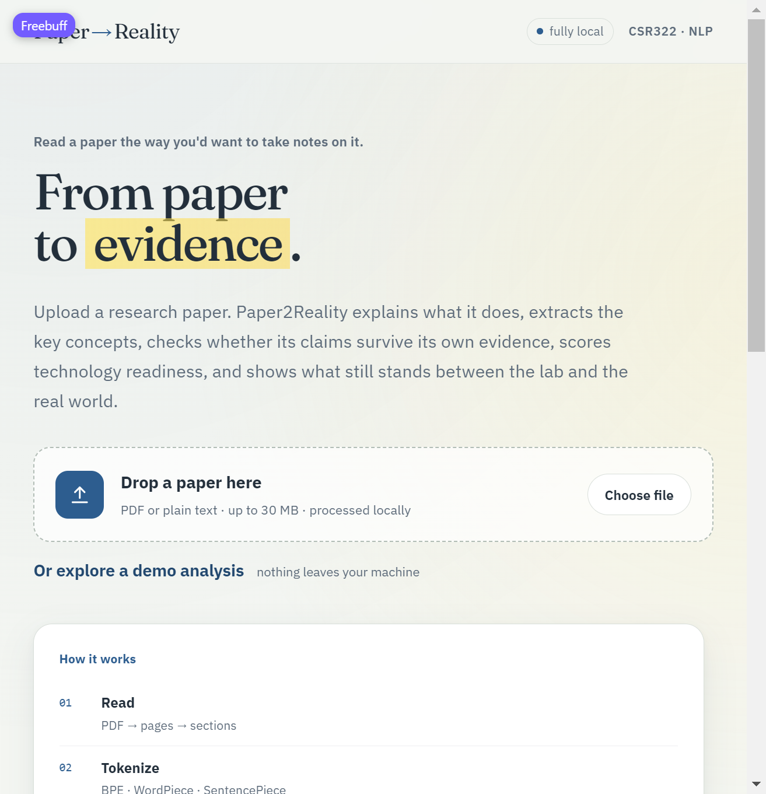
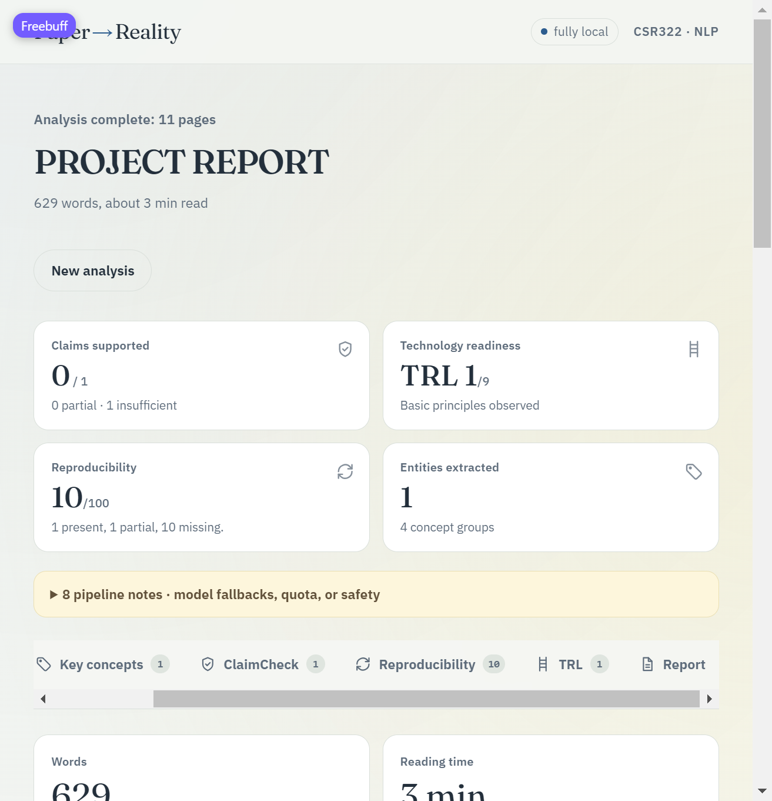
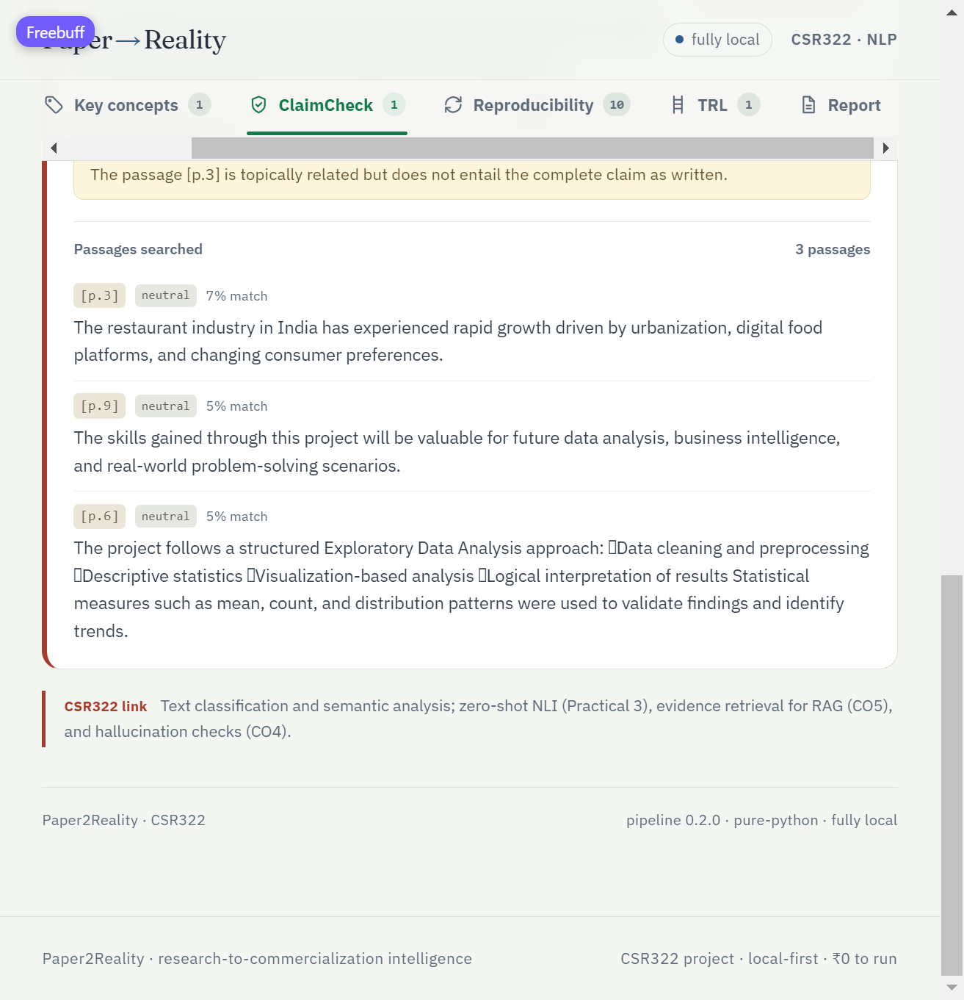
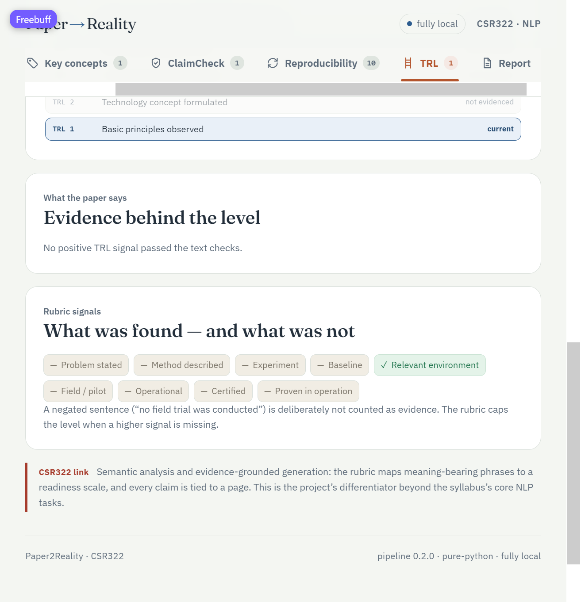

# ThesisTrace

> Formerly named *Paper2Reality*. Repository: <https://github.com/Dhruv-Puri/ThesisTrace>.

**From a research paper to evidence, readiness, and a real-world roadmap.**

A CSR322 (Natural Language Processing) course project. Upload a paper, patent-style
report, or technical note and get:

- a 3-bullet summary and a beginner explanation;
- typed key concepts (datasets, models, metrics, people, organisations);
- **ClaimCheck** — every major claim checked against the paper's own retrieved evidence;
- a **reproducibility audit** with 12 cited signals;
- a **TRL 1–9** readiness level with quoted evidence;
- an **executive report** whose evidence bullets carry a `[p.N]` citation.

It is deliberately *not* a chat-with-your-PDF wrapper: the classical NLP pipeline does
the retrieval, the NLI cross-encoder assigns verdicts, and the optional LLM only writes
prose over already-retrieved text.

The **Ask** tab adds grounded Q&A on top of that same retrieval index: your question
retrieves passages from the paper, only those passages go to Gemini, and answers carry
`[p.N]` citations (any citation that does not match a retrieved page is stripped). Chat
needs `GEMINI_API_KEY`; without one the tab says so instead of answering.

## Screenshots (captured from the running app)

| | |
|---|---|
|  |  |
|  |  |

- Landing page with the highlighter intro and upload/demo entry points
- Dashboard: score cards, pipeline-note transparency, tab bar with counters
- ClaimCheck: a claim's verdict with the exact retrieved passages and page citations
- TRL: the readiness rubric with the signals found (and explicitly not found)

Full gallery: [documentation/screenshots/](documentation/screenshots/) ·
What has been built so far (dated changelog): [documentation/Progress.md](documentation/Progress.md).

---

## Quick start (Docker — recommended)

The host needs only Docker. Python, Node, model weights and spaCy all live inside the
images.

```bash
cp .env.example .env          # optional: add GEMINI_API_KEY
docker compose up --build
```

- Web UI: <http://localhost:8080>
- API health: <http://localhost:8000/api/health>
- The first run downloads model weights into `.data/hf` inside this folder (once).
- All runtime state is project-local: uploads, results and models in `.data/`.

Before a demo, warm the cache:

```bash
docker compose run --rm api python -m api.pipeline.warmup
```

The app works with **no API key**. With a Gemini key it may use the LLM for claim
extraction / report polish, always falling back to local heuristics on any failure.

## Local development (virtualenv only)

The project never needs a global install. Python dependencies go in `.venv`; JS
dependencies go in `client/node_modules` (inside the project). Use Python 3.11 or
3.12 for this path (the Docker image pins 3.11); the container path avoids host
version issues entirely.

### Minimal quick start (what this repo currently runs here)

A lightweight runtime that keeps the app fully working without the multi-GB NLP
stack — the pipeline falls back to its built-in tiers automatically:

```bash
# 1) venv on any available 3.12 (Windows py-launcher or uv):
py -V:3.12 -m venv .venv                    # or: uv venv --python 3.12 .venv
export UV_CACHE_DIR="$PWD/.data/pip-cache"   # caches stay inside the project
uv pip install --python .venv fastapi uvicorn python-multipart pydantic PyMuPDF

# 2) API:
.venv/Scripts/python.exe -m uvicorn api.main:app --host 127.0.0.1 --port 8000

# 3) Web UI (no Node on the machine? use a portable Node zip inside the project):
mkdir -p .data/tools
curl -sL -o .data/tools/node.zip \
  https://nodejs.org/dist/v26.13.0/node-v26.13.0-win-x64.zip
python -c "import zipfile; zipfile.ZipFile('.data/tools/node.zip').extractall('.data/tools')"
export PATH="$PWD/.data/tools/node-v26.13.0-win-x64:$PATH"
cd client && npm install --cache="$PWD/../.data/npm-cache" --no-audit --no-fund
npm run dev                                  # http://127.0.0.1:5173, proxies /api
```

`UV_CACHE_DIR` / `npm --cache` keep every download cache inside `.data/`; the venv,
portable Node and `node_modules` are all project-local. Nothing is installed globally,
and deleting the project folder removes everything.

### Full development stack

```bash
python -m venv .venv
source .venv/bin/activate            # Windows: .venv\Scripts\activate
export PIP_CACHE_DIR="$PWD/.data/pip-cache"
pip install --no-cache-dir -r requirements.txt
PIP_NO_CACHE_DIR=1 python -m spacy download en_core_web_sm
uvicorn api.main:app --reload        # http://127.0.0.1:8000

cd client
npm_config_cache=../.data/npm-cache npm install --no-audit --no-fund
npm run dev                          # http://127.0.0.1:5173, proxies /api
```

`PIP_CACHE_DIR` and `npm_config_cache` keep download caches inside `.data/`; the venv and
`node_modules` are also project-local. Nothing is installed globally.

If a heavy model or library is missing, the pipeline degrades instead of crashing:
extractive summary, gazetteer NER, lexical evidence fallback, template report.

## API

| Method | Path | Purpose |
|---|---|---|
| `GET` | `/api/health` | status, loaded models, dependency check |
| `GET` | `/api/config` | feature flags and limits (never the key) |
| `POST` | `/api/jobs` | upload PDF/TXT/MD → `202` + `job_id` |
| `GET` | `/api/jobs/{id}` | progress, then the full `PaperAnalysis` JSON |
| `GET` | `/api/jobs/{id}/report?format=md` | downloadable markdown report |
| `POST` | `/api/jobs/{id}/chat` | ask a question about the paper (needs Gemini; `503 CHAT_DISABLED` without a key) |

Uploads are limited to 30 MB / 60 pages. One CPU-heavy analysis runs at a time; extra
uploads queue. Progress is visible, which is the honest latency story (CO6).

## Pipeline

```
PDF/TXT → ingest → sentence index → classical features (regex, TF-IDF, POS)
        → tokenizer study (BPE / WordPiece / SentencePiece)
        → NER + scientific gazetteer → summary
        → claim extraction → TF-IDF retrieval → NLI verdict
        → reproducibility checklist → TRL rubric → report
```

| Stage | Implementation |
|---|---|
| Ingest | PyMuPDF pages, section heading regex, page-preserving sentence index |
| Classical | regex facts, scikit-learn TF-IDF (pure-Python fallback), spaCy POS |
| Tokenization | GPT-2 BPE, BERT WordPiece, T5 SentencePiece, classical baseline |
| NER | DistilBERT CoNLL + curated dataset/metric/model gazetteer |
| Summary | DistilBART + FLAN-T5, with numeric-hallucination rejection |
| Claims | few-shot Gemini prompt **or** deterministic result-sentence heuristic |
| Evidence | TF-IDF cosine retrieval, then `cross-encoder/nli-deberta-v3-small` |
| Repro | 12 weighted signals, each with a page citation or an explicit “not reported” |
| TRL | deterministic rubric; negated sentences are not evidence |
| Report | template → optional grounded Gemini polish → citation filter |

## Tests

Standard-library `unittest` — no installs required:

```bash
python -B -m unittest discover -s api/tests -t . -v
```

The suite covers sentence splitting, ingest/sections, TF-IDF retrieval, claim verbatim
checks, NLI-free evidence fallback, reproducibility, TRL negation/review caps, report
citation enforcement, prompt-injection handling, job lifecycle, and the full JSON
contract. Model-backed checks run inside Docker.

## Syllabus alignment (CSR322)

| Syllabus area | Where it lives |
|---|---|
| Tokenization, BPE / WordPiece / SentencePiece | `api/pipeline/tokenizer_study.py`, Overview → tokenizer table (Practical 1) |
| POS, chunking, word classes | spaCy features in `classical.py`, complexity profile |
| Regex, FSA-style rules | heading/reference/citation extraction, gazetteer |
| TF-IDF and feature-based models | `TfidfIndex`, key terms, retrieval |
| NER / information extraction | hybrid model + gazetteer (Practical 2) |
| Summarization / NLG | `summarize.py`, report generator (Practical 4) |
| Text classification / NLI | `evidence.py`, claim verdicts (Practical 3) |
| Prompt engineering (zero/few-shot) | `api/prompts/`, `claims.py` (Practicals 3/5) |
| RAG grounding | retrieve → verify → only cited text reaches the LLM (CO5) |
| Hallucination / prompt injection | numeric checks, verbatim checks, citation filter, injection tests (CO4) |
| Evaluation and error analysis | `api/tests/`, [documentation/Evaluation.md](documentation/Evaluation.md) (Practical 6) |
| Production concerns | background jobs, timings, `LOW_RAM`, model fallbacks (CO6) |
| End-to-end pipeline | the whole service (Practical 8) |

Full mapping: [documentation/Concepts-and-Syllabus.md](documentation/Concepts-and-Syllabus.md).

## Data and privacy

- Uploads, job results and model weights live in `.data/` (git-ignored), bind-mounted
  into the containers. Nothing is written to a system path or a hidden Docker volume.
- Delete `.data/` to remove runtime data. To remove the built images too:
  `docker compose down --rmi local && rm -rf .data`. Deleting the project folder then
  removes everything this project created (Docker's own image cache is managed by Docker).
- Uploaded papers are served only to the local API. No analytics, no external calls
  unless you set `GEMINI_API_KEY`.
  With a key, the Ask tab sends your question and the few retrieved passages to Gemini, never the whole file.

## Repository map

```
api/                 FastAPI app, job runner, NLP pipeline, prompt templates, tests
client/              React + Vite dashboard (6 tabs, demo fixture)
documentation/       design docs, syllabus mapping, feasibility, roadmap, setup
Dockerfile.api       CPU-only API + model image
Dockerfile.web       Vite build served by nginx
docker-compose.yml   api + web, project-local .data mounts
requirements.txt     Python dependencies (installed only in Docker / .venv)
```

Start with [documentation/README.md](documentation/README.md); the architecture and
pipeline specs are [documentation/Architecture.md](documentation/Architecture.md) and
[documentation/NLP-Pipeline.md](documentation/NLP-Pipeline.md). A dated changelog of everything built so far lives in the
[documentation/Progress.md](documentation/Progress.md) status section.
