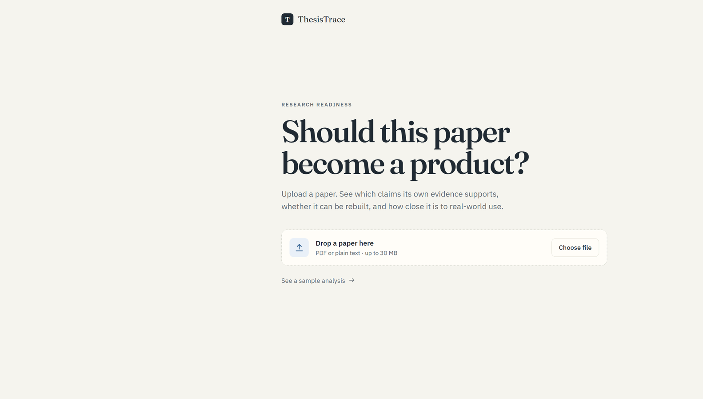
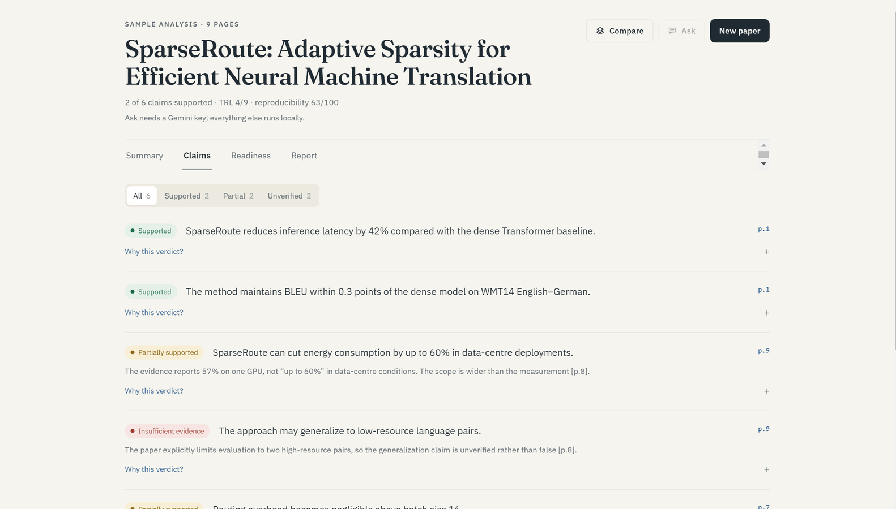
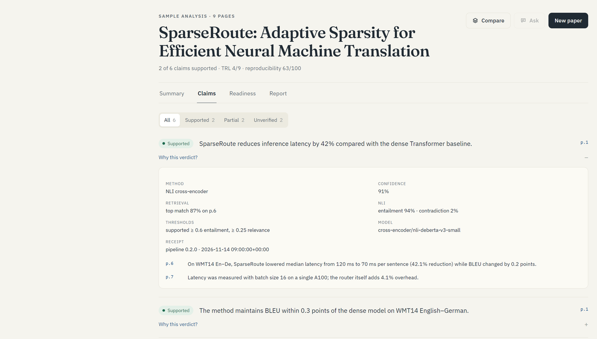
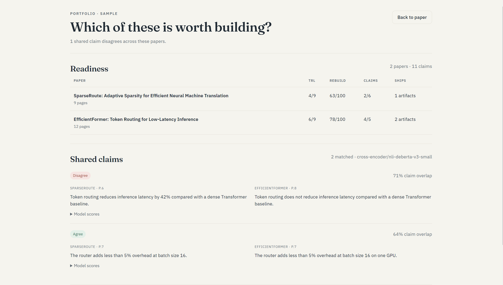

# Progress Tracker — ThesisTrace

**Sprint length:** 4 weeks (3–4 weeks until submission)
**Roles (3 members):** P1 = NLP core · P2 = FastAPI backend + jobs · P3 = React frontend + docs/evaluation
*Adjust names/roles to your actual team size — keep the role boundaries.*

**Status legend:** `⬜` not started · `🔶` in progress · `✅` done · `⛔` blocked

> **Implementation pass (code):** the pipeline, job runner, API, React tabs, Docker
> files and stdlib test suite are written. `✅` below means the code path exists and is
> covered by the local fallback tests; `🔶` means it still needs the model-backed Docker
> run on a real paper before Gate A/B/C is signed off.

---

## Where the project stands (verified on this checkout)

Last updated: **2026-11-14** · branch `main`

| Layer | State | How it was verified |
|---|---|---|
| NLP pipeline (all 9 stages) | ✅ Code complete, runs **fully local** on CPU | Real 11-page student-project PDF analysed end-to-end via the live UI |
| FastAPI backend + job runner | ✅ Running | `POST /api/jobs` → progress → result JSON served to the browser |
| React dashboard (4 tabs + portfolio) | ✅ Running, rebuilt | Click-through: Summary → Claims → Readiness → Report; Trust Ledger disclosure; sample portfolio |
| Docker files | ✅ Written, committed | Structure reviewed; a full `docker compose up` cold start is still pending (Gate C) |
| Test suite | ✅ Passing | stdlib `unittest`, no installs needed |
| Documentation set | ✅ 10 documents in this folder | Indexed in [README.md](README.md) |
| Visual identity | ✅ "Annotated paper" redesign committed | Browser check + [screenshots/](screenshots/) gallery below |

Run status of the demo analysis that produced the screenshots: **fully local,
pure-python fallback tier** (no LLM key, no model download) — exactly the degraded path
we designed, so it doubles as proof that graceful degradation works.

### Git history (what each commit added)

| Commit | What it contains |
|---|---|
| `8f1298a` | Initial commit: syllabus PDF, idea file, docs first draft |
| `296fca0` / `9ddc3ec` | Directory structure (api / client / documentation); untrack ignored artifacts |
| `07423a7` | Code Update 1: full pipeline, API, frontend, Docker files, tests |
| `b2966dc` | Documented the **minimal local run path** (portable Node zip + venv, no global installs); pinned client dependencies |
| `eef815d` | **Frontend redesign** — annotated-paper theme, self-hosted fonts, highlighter intro animation, favicon, copy pass |
| `4594500` | Inline SVG icon component used by tabs and cards (dependency of the redesign) |
| `6bbad25` | Screenshot gallery + this changelog section; root-anchored gitignore screenshot rule |

### 2026-11-14 — differentiation, audit trail, UI rebuild

| Change | Detail |
|---|---|
| Trust Ledger | Every claim carries an `audit` receipt: retrieval k/scores/floor, NLI probabilities, thresholds, model, pipeline version, timestamp, abstain reason. `GET /api/jobs/{id}/audit` exports it. |
| Portfolio | `api/pipeline/portfolio.py` compares 2–5 analyses: readiness table + near-duplicate claims scored in both directions as agree/conflict/unscored. `POST /api/portfolios`, `GET /api/portfolios/{id}`. |
| Evaluation harness | `eval/run_eval.py` reports verdict accuracy, per-class P/R/F1, recall@k, citation coverage and latency with N. Seed set: 15 developer-labelled cases. |
| UI rebuild | 7 tabs → 4; duplicated score cards removed; syllabus kickers moved out of the product; claims collapse to claim + verdict + page; receipts behind "Why this verdict?". |
| Business documents | Competitive analysis (incl. PaperLens), business plan, validation plan, production readiness. |
| Deck | Rebuilt: 15 core slides + 3 appendix, measured numbers with N, honest competitor row, team slide, demo script. |

Still open: model-backed tier has not been timed; gold labels are a seed set; no auth/quota;
interviews not yet conducted.

## What was built so far (by layer)

### Backend — `api/`

- **Pipeline stages** (`api/pipeline/`), in processing order, each with a fallback tier
  when a dependency or model is missing (the container or a slow machine can strip any
  stage and the app still works):
  1. `ingest.py` — PyMuPDF page extraction with a stdlib plain-text path; section
     heading regexes; page-preserving sentence index (every sentence knows its page —
     the foundation of the citation rule).
  2. `tokenizer_study.py` — the syllabus tokenization comparison (Practical 1):
     BPE vs WordPiece vs SentencePiece vs a classical regex baseline, pure-python
     fallback when transformers are not installed.
  3. `classical.py` — TF-IDF key terms and similarity retrieval (pure-Python fallback),
     regex fact spotting, POS/complexity profile when spaCy is available.
  4. `repro.py` — 12-signal reproducibility checklist with per-signal page citations or
     explicit "not reported"; negation-aware ("no field trial" is not positive evidence).
  5. `claims.py` — claim extraction: few-shot LLM prompt **or** deterministic
     result-sentence heuristic; verbatim-claim guard so nothing is invented.
  6. `evidence.py` — TF-IDF retrieval of candidate passages (claim's own sentence
     excluded), then NLI verdicts (support / partial / insufficient) when the
     cross-encoder is present, else lexical-match verdicts with page citations.
  7. `summarize.py` — 3-bullet summary + ELI5 mode; numeric-hallucination rejection.
  8. TRL 1–9 rubric — deterministic scorer with a review cap and cited evidence per level.
  9. `report.py` — executive report; template first, optional grounded Gemini polish; a
     final **citation filter** that drops any sentence lacking a `[p.N]` it can back.
- **API** (`main.py`, `jobs/runner.py`): `/api/health`, `/api/config` (never the key),
  `POST /api/jobs` (≤ 30 MB / 60 pages → `202` + job id), `GET /api/jobs/{id}`
  (progress → full `PaperAnalysis` JSON), `GET /api/jobs/{id}/report?format=md`.
  One CPU-heavy analysis at a time (semaphore); extra uploads queue with visible
  progress — the honest latency story for CO6. All job state lives in project-local
  `.data/`; nothing is written outside the project folder.
- **LLM layer** (`llm.py`, `api/prompts/`): stdlib-only Gemini REST adapter (no SDK),
  key optional, silent fallback to heuristics on any failure. Prompt templates are
  versioned text files (`claims.txt`, `eli5.txt`, `report.txt`, `evidence_note.txt`).
  Anti-injection hardening: the uploaded document is treated as **untrusted data**
  (fenced, labelled), outputs schema-constrained, injection attempts covered by tests.
- **Tests** (`api/tests/`, stdlib `unittest` — no installs):
  `python -B -m unittest discover -s api/tests -t . -v`
  Covers sentence splitting, ingest/sections, TF-IDF retrieval, claim verbatim checks,
  NLI-free evidence fallback, reproducibility, TRL negation/review caps, report citation
  enforcement, prompt injection, job lifecycle, and the full JSON contract.

### Frontend — `client/`

- React + Vite (18 / 5); only `recharts` beyond the React core.
- Four tabs: **Summary, Claims, Readiness, Report**, plus a **Portfolio** screen for 2–5 papers.
- **Demo mode**: full sample `PaperAnalysis` fixture — the whole product is viewable
  without a backend ("nothing leaves your machine"), useful for teammates and demos.
- One verdict line in the header instead of four duplicate score cards; no tab counters;
  syllabus links live in the report appendix, not the product.
- Claims show claim + verdict + page; evidence and the Trust Ledger sit behind one
  disclosure. Readiness merges the TRL ladder with the reproducibility gaps.
- **Redesign** (`eef815d` — "Marginalia" theme): identity derived from the product —
  *a paper marked up with a pen and a highlighter*. Palette: desk paper `#f4f6f2`,
  white sheets, ink navy `#232f3b`, pen blue `#2d5d8f`, highlighter yellow used exactly
  once (intro animation). Self-hosted **Fraunces** + **IBM Plex Sans** (~110 KB, offline).
  One decorative animation only — the highlighter sweep on "*From paper to **evidence***".
  Sentence-case labels, mono reserved for data, pen-blue favicon.

### Containerization

- `Dockerfile.api` (CPU-only Python 3.11 image), `Dockerfile.web` (Vite build + nginx,
  `client/nginx.conf`), `docker-compose.yml` (api + web, `.data/` bind-mounted so
  uploads/weights stay project-local and delete-able), `.dockerignore` for small images.

### "Nothing global on the host" policy (verified path)

Documented in the root [README](../README.md), committed in `b2966dc`: Python deps in
project `.venv` (`PIP_CACHE_DIR` inside `.data/`); Node either in `client/node_modules`
or a **portable Node zip** extracted to `.data/tools/` (no Node install at all); npm/pip
caches inside `.data/`. Deleting `.data/` + `.venv/` + `node_modules/` removes every byte
the project downloaded. An npm-equipped teammate needs nothing extra: clone → `npm install`.

## Screenshot gallery (captured from the live app)

### Start — one headline, one action



### Claims — verdicts, pages, reasons



### Trust Ledger — the receipt behind one verdict



### Portfolio — readiness table and shared claims



---

## Phase A — NLP MVP (Week 1) → *demoable by Friday*

| # | Task | Owner | Status | Blockers / notes |
|---|------|-------|--------|------------------|
| A1 | Project scaffold: git repo, `.venv`, `requirements.txt`, folder layout | P1 | ✅ | Docker-first; no host venv required, project-local `.data/` for state |
| A2 | PDF text extraction (PyMuPDF): pages, sections, word counts, reading time | P1 | 🔶 | code done; PDF path needs Docker/PyMuPDF verification |
| A3 | Tokenization study: HF tokenizer vs spaCy vs regex — BPE vs WordPiece vs SentencePiece (Practical 1) | P1 | 🔶 | baseline verified; HF tokenizers need Docker cache |
| A4 | Sentence segmentation + reading stats (words, pages, sections, references count) | P1 | ✅ | |
| A5 | TF-IDF key terms + technical-term density + complexity score | P1 | ✅ | sklearn + pure-Python fallback |
| A6 | NER: HF small NER model + gazetteer for scientific terms (datasets, metrics, models) | P1 | 🔶 | gazetteer verified; HF model needs Docker |
| A7 | Summarization: pretrained transformer → 3-bullet summary + ELI5 mode (Practical 4) | P1 | 🔶 | extractive fallback verified; model path needs Docker |
| A8 | `POST /api/jobs` + `GET /api/jobs/{id}` returning `PaperAnalysis` JSON | P2 | ✅ | contract in [Architecture.md](Architecture.md) |
| A9 | React shell: upload page + Paper Overview tab + Key Concepts tab | P3 | ✅ | plus demo mode; `npm run build` still to verify |
| A10 | **GATE A demo:** upload PDF → stats + bullets + entities on screen | all | ⬜ | Fri Week 1 |

## Phase B — Evidence layer (Week 2) → *ClaimCheck works end-to-end*

| # | Task | Owner | Status | Blockers / notes |
|---|------|-------|--------|------------------|
| B1 | Claim extraction: few-shot prompted extraction of major claims (Practical 3) | P1 | ✅ | prompt + heuristic fallback |
| B2 | Sentence-level retrieval: TF-IDF + cosine similarity, top-k evidence candidates | P1 | ✅ | claim's own sentence excluded |
| B3 | NLI verdict per claim: support / partially supported / insufficient (DistilBERT MNLI) | P1 | 🔶 | thresholds written; model path needs Docker |
| B4 | Evidence cards: claim → passages → verdict → page citation | P2 | ✅ | no citation, no verdict — hard rule |
| B5 | Zero-shot classification experiment: NLI model vs prompt-based labels (Practical 3) | P1 | ⬜ | |
| B6 | Prompt-vs-model comparison: prompt-based summary/claims vs fine-tuned/small model (Practical 5) | P1 | ⬜ | record for report |
| B7 | Frontend: ClaimCheck tab with 🟢/🟡/🔴 verdicts + evidence snippets | P3 | ✅ | |
| B8 | Hand-label 50 evidence pairs as gold set (see [Evaluation.md](Evaluation.md)) | P3 | ⬜ | start early, label in batches |
| B9 | **GATE B demo:** claim on screen → verdict + cited passage | all | ⬜ | Fri Week 2 |

## Phase C — App + TRL report (Week 3)

| # | Task | Owner | Status | Blockers / notes |
|---|------|-------|--------|------------------|
| C1 | Reproducibility checklist extraction (rule/keyword-based from methods sections) | P1 | ✅ | 12 weighted signals |
| C2 | TRL 1–9 rubric scorer: evidence-cited, deterministic first; optional Gemini wording | P1 | ✅ | negation-aware, review cap |
| C3 | Optional Gemini layer (free key): claim extraction, report polish | P2 | ✅ | stdlib REST adapter; key optional |
| C4 | Prompt hardening: document-as-untrusted-data, JSON-schema outputs (Practical 3) | P2 | ✅ | sanitizer + injection tests |
| C5 | Async job flow: upload → job id → poll → result (long analyses don't block) | P2 | ✅ | queued behind one-CPU semaphore |
| C6 | Frontend: Reproducibility + TRL tabs, Executive Report view | P3 | ✅ | |
| C7 | Docker: `Dockerfile.api`, `Dockerfile.web`, `docker-compose.yml` up on all machines | P2 | 🔶 | files written; needs a real `docker compose up` |
| C8 | **GATE C demo:** full click-through, works from `docker compose up` on a clean laptop | all | ⬜ | Fri Week 3 |

## Phase D — Evaluation, buffer, demo (Week 4)

| # | Task | Owner | Status | Blockers / notes |
|---|------|-------|--------|------------------|
| D1 | Run full metric suite: ROUGE, entity F1, claim macro-F1, entailment acc, recall@k | P1+P3 | ⬜ | [Evaluation.md](Evaluation.md) |
| D2 | Error analysis: categorize failures (extraction/retrieval/reasoning/generation) | all | ⬜ | 10 worst cases table in report |
| D3 | Tokenization & prompt design impact experiment write-up (Practical 7) | P1 | ⬜ | |
| D4 | End-to-end pipeline description for report (Practical 8) | P1 | ⬜ | |
| D5 | Concept ↔ syllabus table final check for viva (CO1–CO6 talking points) | P3 | ⬜ | [Concepts-and-Syllabus.md](Concepts-and-Syllabus.md) |
| D6 | Demo rehearsal + slide deck + report assembly | all | ⬜ | |
| D7 | **FINAL DEMO** | all | ⬜ | |

---

## What is *not* done yet (so nobody assumes it is)

- **Gate A/B/C model-backed runs**: the transformer tiers (HF tokenizer table, DistilBERT
  NER, DistilBART/FLAN-T5 summary, NLI cross-encoder) have never executed against a real
  paper yet — the Docker/model layer is written but needs its first cold
  `docker compose up --build`. Until then the shipped analysis used the pure-python
  fallback tiers.
- **Phase D evaluation**: gold-set hand-labelling (50 pairs), ROUGE/macro-F1/recall@k
  numbers, the 10-worst-errors table, and the report chapters (see
  [Evaluation.md](Evaluation.md)).
- Demo-day rehearsal items: pre-warmed model cache, key-removed graceful-degradation
  test in the *container*, backup screenshots/video.
- One more `npm run build` production-bundle check before Gate C.

---

## Weekly standup log (copy per meeting)

```
Date:
Since last:      (what actually got done)
Next:            (max 3 items each)
Blockers:        (anything needing a decision or a download/machine)
Decisions made:  (e.g., "swap flan-t5-small → distilbart for quality")
```

## Definition of Done (per phase)

- Feature works on a **real paper** (not a toy string), on a laptop with **no GPU**.
- Every number/verdict shown in UI has a **citation or provenance** (page/sentence or "heuristic").
- Code pushed; `docker compose up` still works (Phase C onward).
- One entry added to the report/log: screenshot + metric or observation.

## Demo-day checklist

- [ ] Sample papers downloaded in advance (1 CS, 1 medical/energy — diversity sells TRL story)
- [ ] App pre-warmed: models downloaded into `.data/hf` (first run downloads weights)
- [ ] Gemini key in `.env` **optional path tested with key removed** (graceful degradation)
- [ ] Backup: screenshots/video of the full flow in case of Wi-Fi failure
- [ ] Slides include: pipeline diagram, syllabus mapping table, metrics table, 10 worst errors
