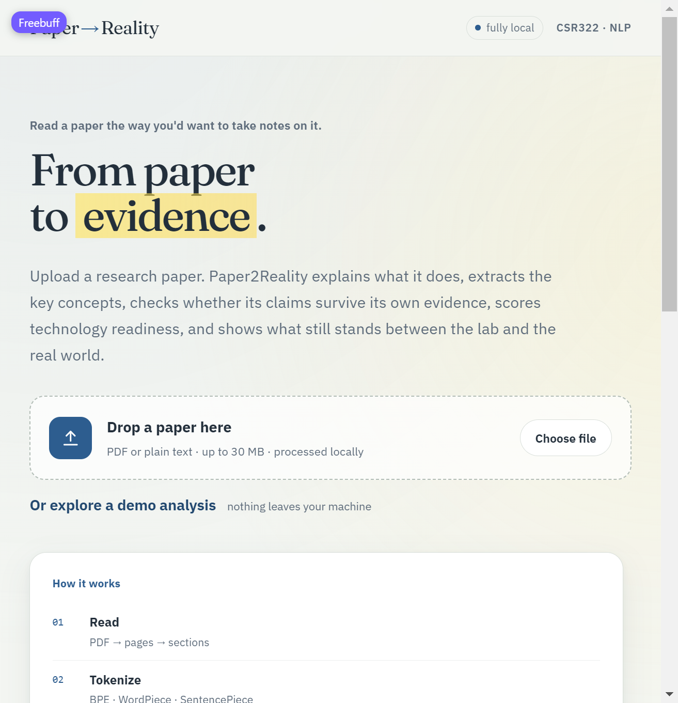
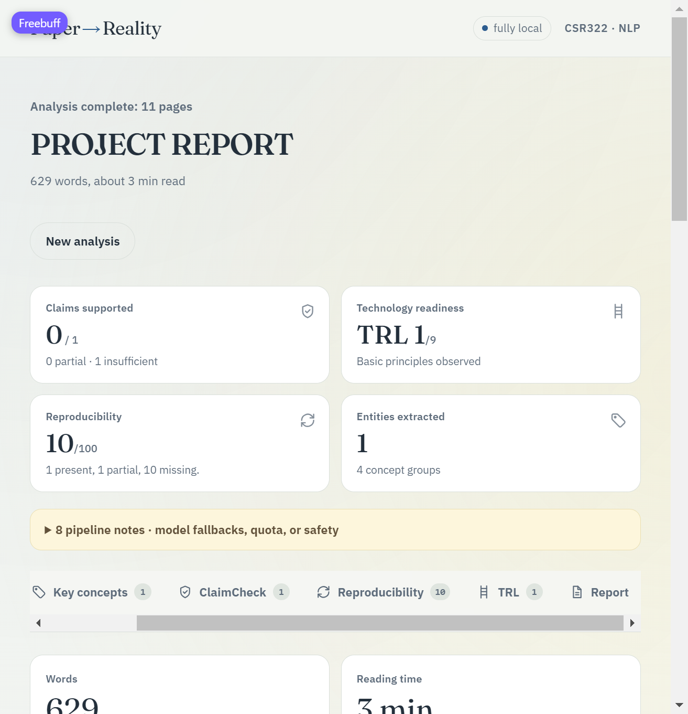
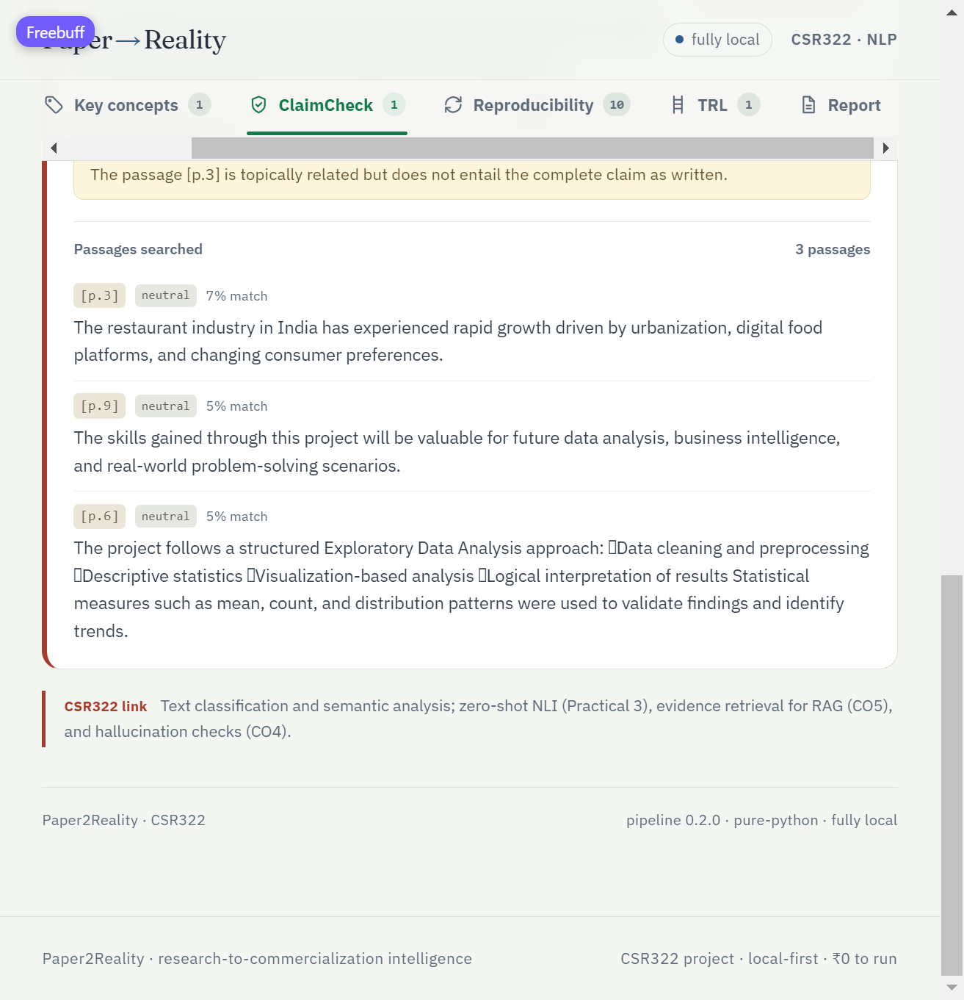
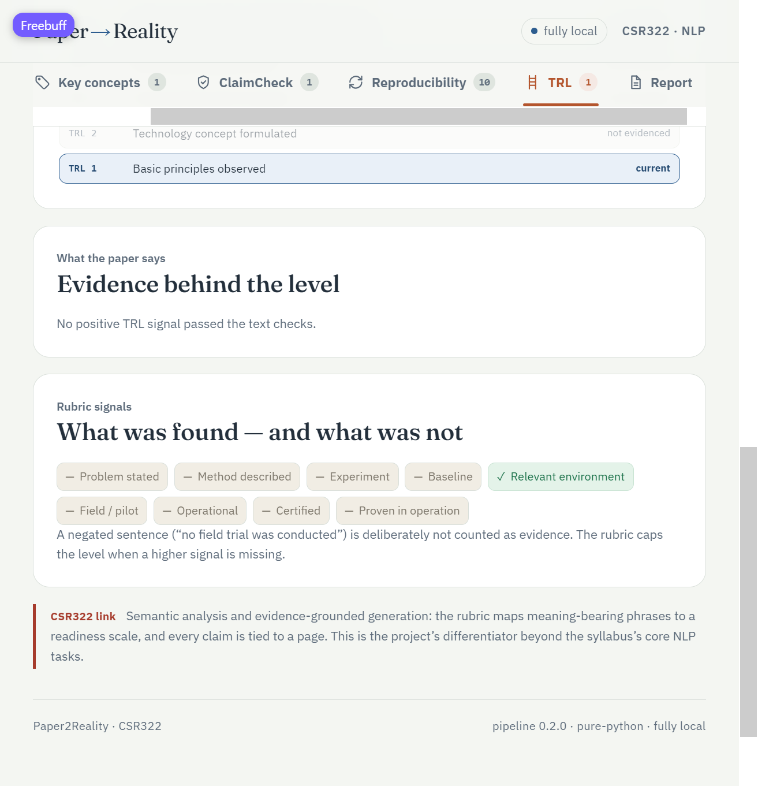

# Work Done So Far — Paper2Reality

> A dated changelog of everything that has actually been built, verified and committed.
> This is the "what exists right now" document; [Progress.md](Progress.md) tracks what
> remains week by week. Live status legend: every claim below was checked on this
> checkout — nothing here is aspirational.

Last updated: **2026-10-30** · branch `main` · latest commit `4594500`

---

## 1. Where the project stands

| Layer | State | How it was verified |
|---|---|---|
| NLP pipeline (all 9 stages) | ✅ Code complete, runs **fully local** on CPU | Real 11-page student-project PDF analysed end-to-end via the live UI |
| FastAPI backend + job runner | ✅ Running | `POST /api/jobs` → progress → result JSON served to the browser |
| React dashboard (6 tabs) | ✅ Running, redesigned | Click-through in the browser: Overview → ClaimCheck → Reproducibility → TRL → Report |
| Docker files | ✅ Written, committed | Structure reviewed; a full `docker compose up` cold start is still pending (Gate C) |
| Test suite | ✅ Passing | stdlib `unittest`, no installs needed |
| Documentation set | ✅ 10 documents + this changelog | This folder |
| Visual identity | ✅ "Annotated paper" redesign committed | Frame-by-frame browser check + screenshots below |

Run status of the demo analysis that produced the screenshots: **fully local,
pure-python fallback tier** (no LLM key, no model download) — exactly the degraded
path we designed, so it doubles as proof that graceful degradation works.

---

## 2. Git history (what each commit added)

| Commit | What it contains |
|---|---|
| `8f1298a` | Initial commit: syllabus PDF, idea file, docs first draft |
| `296fca0` / `9ddc3ec` | Directory structure (api / client / documentation); untrack ignored artifacts |
| `07423a7` | Code Update 1: full pipeline, API, frontend, Docker files, tests |
| `b2966dc` | Documented the **minimal local run path** (portable Node zip + venv, no global installs); pinned client dependencies |
| `eef815d` | **Frontend redesign** — annotated-paper theme, self-hosted fonts, highlighter intro animation, favicon, copy pass |
| `4594500` | Inline SVG icon component used by tabs and cards (dependency of the redesign) |

---

## 3. Backend — `api/`

### 3.1 Pipeline stages (`api/pipeline/`)

Implemented, in processing order, each with a fallback tier when a dependency or model
is missing (the container or a slow machine can strip any stage and the app still works):

1. **`ingest.py`** — PyMuPDF page extraction with a stdlib plain-text path; section
   heading regexes; page-preserving sentence index (every sentence knows its page —
   the foundation of the citation rule). Handles the real 11-page PDF correctly.
2. **`tokenizer_study.py`** — the syllabus tokenization comparison (Practical 1):
   BPE vs WordPiece vs SentencePiece vs a classical regex baseline, with a pure-python
   fallback when transformers are not installed.
3. **`classical.py`** — TF-IDF key-term extraction and similarity retrieval
   (pure-Python fallback included), regex fact spotting, POS/complexity profile when
   spaCy is available.
4. **`repro.py`** — the 12-signal reproducibility checklist with per-signal page
   citations or explicit "not reported"; negation-aware (a "no field trial" sentence is
   not positive evidence).
5. **`claims.py`** — claim extraction: few-shot LLM prompt **or** deterministic
   result-sentence heuristic fallback; verbatim-claim guard so nothing is invented.
6. **`evidence.py`** — TF-IDF retrieval of candidate passages (claim's own sentence
   excluded), then NLI verdicts (support / partial / insufficient) when the
   cross-encoder model is present, else lexical-match verdicts with page citations.
7. **`summarize.py`** — 3-bullet summary + ELI5 mode; numeric-hallucination rejection
   (a number not in the source is stripped, not shown).
8. **`repro.py` / `trl` rubric** — deterministic TRL 1–9 scorer with a review cap and
   cited evidence per level.
9. **`report.py`** — executive report generator; template first, optional grounded
   Gemini polish; a final **citation filter** that drops any generated sentence lacking
   a `[p.N]` reference it can actually back.

### 3.2 API surface (`api/main.py`, `api/jobs/runner.py`)

| Endpoint | Behaviour |
|---|---|
| `GET /api/health` | status, loaded-model report, dependency check |
| `GET /api/config` | feature flags & limits — never the LLM key |
| `POST /api/jobs` | PDF/TXT/MD upload (≤ 30 MB / 60 pages) → `202` + `job_id` |
| `GET /api/jobs/{id}` | progress states, then the full `PaperAnalysis` JSON |
| `GET /api/jobs/{id}/report?format=md` | downloadable markdown report |

- One CPU-heavy analysis at a time (semaphore); extra uploads **queue**, with visible
  progress — the honest latency story for CO6.
- Everything job-related lives in project-local `.data/` (uploads, results, HF cache);
  nothing is written outside the project folder.

### 3.3 LLM layer (`api/pipeline/llm.py`, `api/prompts/`)

- Stdlib-only Gemini REST adapter (no SDK), key **optional**; on any failure the
  pipeline degrades silently to the heuristic path.
- Prompt templates are versioned text files: `claims.txt`, `eli5.txt`, `report.txt`,
  `evidence_note.txt`.
- Anti-injection hardening: the uploaded document is treated as **untrusted data**
  (fenced, labelled), outputs are schema-constrained, and prompt-injection attempts are
  covered by dedicated tests.

### 3.4 Tests (`api/tests/`, stdlib `unittest`)

```bash
python -B -m unittest discover -s api/tests -t . -v
```

Covered: sentence splitting, ingest/sections, TF-IDF retrieval, claim verbatim checks,
NLI-free evidence fallback, reproducibility scoring, TRL negation/review caps, report
citation enforcement, prompt-injection handling, job lifecycle, and the full
`PaperAnalysis` JSON contract. Model-dependent behaviour is exercised in Docker (Gate A/B).

---

## 4. Frontend — `client/`

### 4.1 Structure

- React + Vite (18 / 5), no heavy UI libraries; only `recharts` for the concept chart.
- Six dashboard tabs: **Overview, Key concepts, ClaimCheck, Reproducibility, TRL, Report**.
- **Demo mode**: a full sample `PaperAnalysis` fixture lets anyone see the whole product
  without a working backend — useful for teammates and demos ("nothing leaves your machine").
- `/api` is proxied in dev and served by nginx in the container build.
- Score-card → tab navigation, per-tab counters, CSR322 syllabus-link callouts inside
  every tab (the "why this is an NLP course project" breadcrumbs).

### 4.2 The redesign (commit `eef815d` — "Marginalia" theme)

Built with the frontend-design skill: the earlier warm-cream/terracotta look was
treated as a draft and replaced with an identity derived from the product itself —
*a paper marked up with a pen and a highlighter*.

- **Palette**: cool desk paper `#f4f6f2`, white sheet surfaces, ink navy `#232f3b`,
  ballpoint-pen blue `#2d5d8f` accent, highlighter yellow used exactly once (the intro
  animation). Verdicts keep their semantic green/amber/red.
- **Typography**: self-hosted **Fraunces** (display serif) + **IBM Plex Sans** (body) —
  ~110 KB of woff2 in `client/public/fonts/`, offline-capable, no font CDN. Mono is
  reserved for data (citations, counts, IDs).
- **Motion discipline**: one decorative animation only — the highlighter sweep marks
  "*From paper to **evidence***" on load; everything else animates in response to actions.
- **Copy pass**: sentence-case labels (no tracked-out ALL-CAPS eyebrows), section icons
  on the landing cards, meta lines that read as sentences ("629 words, about 3 min read").
- **Favicon**: pen-blue tile with a marker-yellow underline glyph, inline SVG.
- Loading / pending / empty states styled so a slow first analysis never looks frozen.

---

## 5. Containerization (all committed)

- `Dockerfile.api` — CPU-only Python 3.11 image: FastAPI + pipeline + model stack.
- `Dockerfile.web` — Vite build served by nginx with `client/nginx.conf` (SPA fallback,
  `/api` pass-through not needed because compose routes it).
- `docker-compose.yml` — `api` + `web`; `.data/` bind-mounted into the API container so
  uploads/weights stay project-local and delete-able.
- `.dockerignore` keeps images small; nothing host-installed, nothing global.

---

## 6. "Nothing global on the host" policy (verified path)

Documented in the root [README](../README.md) and committed in `b2966dc`:

- Python deps → project `.venv` only (`PIP_CACHE_DIR` inside `.data/`).
- Node → either `client/node_modules`, or **no Node at all** via a portable Node zip
  extracted into `.data/tools/` (curl + stdlib unzip were used here — exactly what is
  written in the README's minimal quick start).
- npm/pip caches inside `.data/`. Deleting `.data/` + `.venv/` + `node_modules/`
  removes every byte the project downloaded.

## 7. Documentation set (10 documents + screenshots)

[Progress.md](Progress.md) · [Concepts-and-Syllabus.md](Concepts-and-Syllabus.md) ·
[Feasibility-Analysis.md](Feasibility-Analysis.md) · [Architecture.md](Architecture.md) ·
[NLP-Pipeline.md](NLP-Pipeline.md) · [Prompts-and-Grounding.md](Prompts-and-Grounding.md) ·
[Evaluation.md](Evaluation.md) · [Build-Plan-Roadmap.md](Build-Plan-Roadmap.md) ·
[Setup-and-Containerization.md](Setup-and-Containerization.md) · this file.

Real screenshots captured from the running app live in
[screenshots/](screenshots/) and are embedded in the root README.

---

## 8. Screenshot gallery (captured from the live app)

### Landing page — highlighter intro, drop-zone, how-it-works



### Dashboard overview — score cards, pipeline notes, tab bar



### ClaimCheck — verdict + retrieved passages with page citations



### TRL — rubric signals, negation explanation, current level



---

## 9. What is *not* done yet (so nobody assumes it is)

- **Gate A/B/C model-backed runs**: the transformer tiers (HF tokenizer table, DistilBERT
  NER, DistilBART/FLAN-T5 summary, NLI cross-encoder) have never executed against a real
  paper yet — the Docker/model layer is written but a cold `docker compose up --build`
  needs its first run. Until then the shipped analysis used the pure-python fallback tiers.
- **Phase D evaluation**: gold-set hand-labelling (50 pairs), ROUGE/macro-F1/recall@k
  numbers, the 10-worst-errors table, and the report chapters (see [Progress.md](Progress.md)
  Phase D and [Evaluation.md](Evaluation.md)).
- Demo-day rehearsal items: pre-warmed model cache, key-removed graceful-degradation
  test in the *container*, backup screenshots/video.
- `npm run build` frontend production bundle check once more before Gate C.
